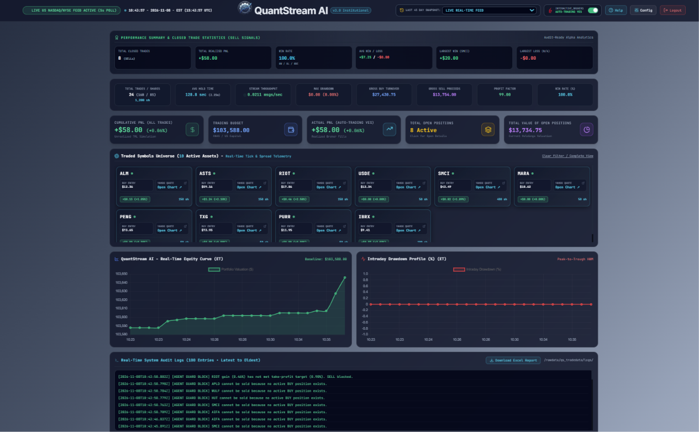
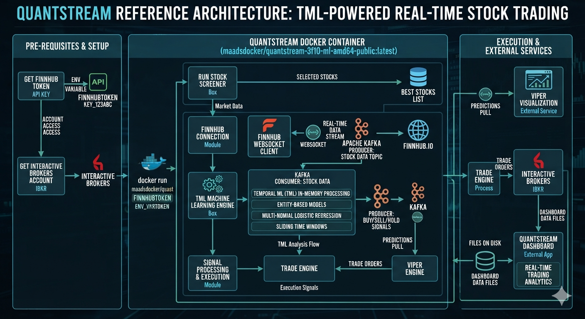
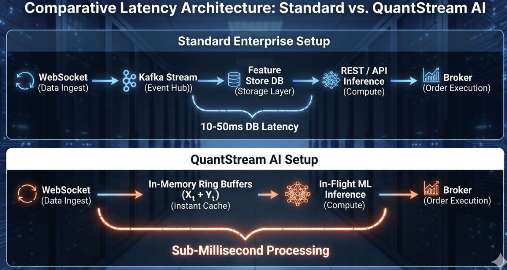
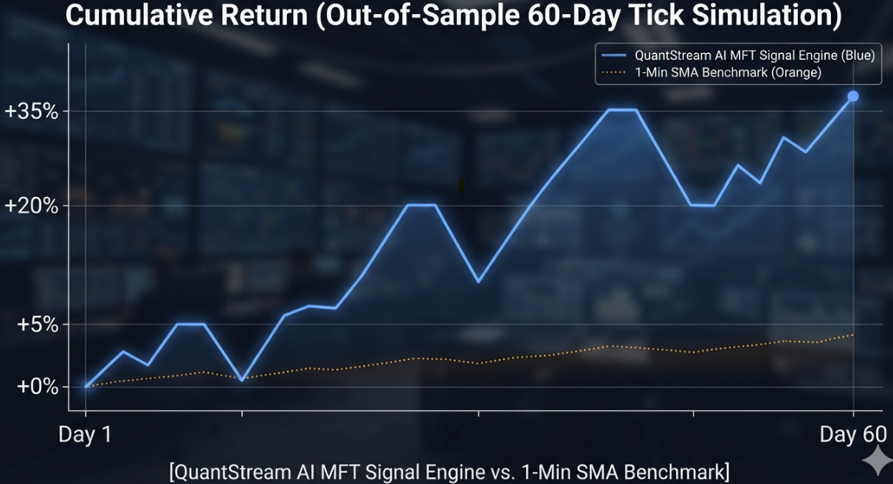
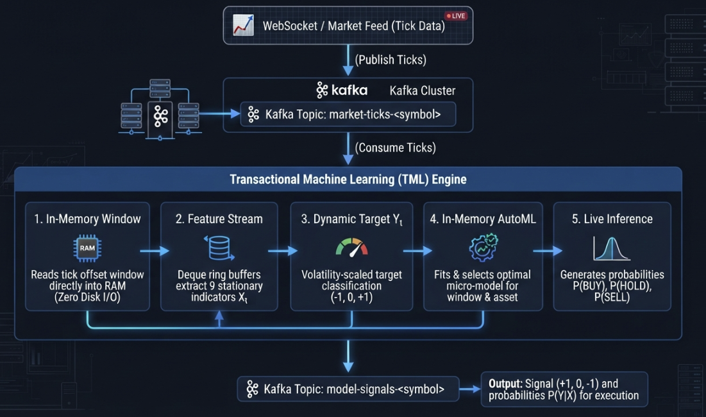
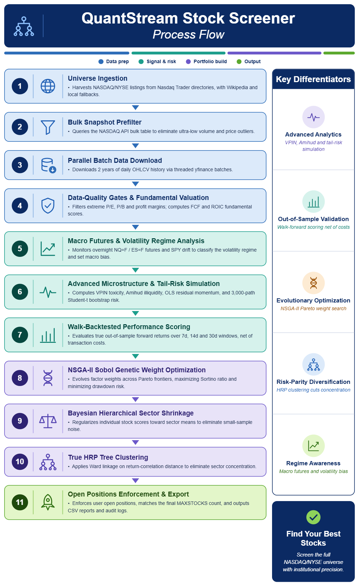
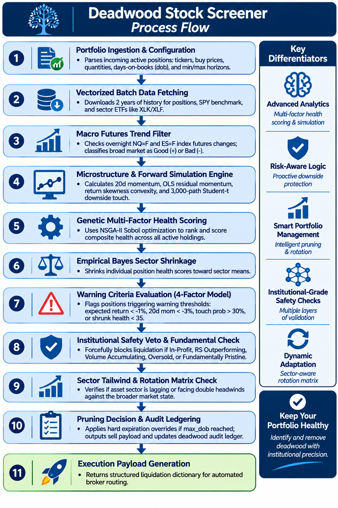

========================================================================================
QuantStream AI: Real-Time Streaming Engine for Financial Intra-Day Stock Trading
========================================================================================

**Objective of QuantStream AI is to democratize High Frequency Trading (HFT).  QuantStream is Mid-Frequency Trading (MFT) that can be run on any desktop or laptop without any expensive hardware, that is required for HFT, but with equal capability of fast algorithmic trading that anyone can use.**

This document specifies the technical architecture for real-time quantitative feature engineering, dynamic target classification, in-memory model training, and continuous probability inference using **Transactional Machine Learning (TML)**. 

Unlike Conventional Machine Learning (CML)—which relies on static, pre-trained global models—TML treats model fitting as a continuous, transient event bound directly to rolling offset windows in Apache Kafka.

.. important::

    Disclaimer: QuantStream AI is an advanced quantitative multi-tick alpha prediction engine designed for analytical, research, and simulation purposes only. Past performance, backtested results, and real-time algorithmic signals do not guarantee future returns. Algorithmic trading involves substantial risk of loss and is not suitable for every investor. Otics Advanced Analytics, Inc. assumes no responsibility for financial losses incurred using this terminal.

.. note::

   Watch the `QuantStream AI Youtube video <https://www.youtube.com/watch?v=Oe9MF_rvebs>`_

.. contents:: Table of Contents
   :local:
   :depth: 2

---

QuantStream AI TML Implementation
========================================

.. note::
   
    Access to this solution is available from Docker hub.  See below for container details.

QuantStream AI Container Details
-------------------------------

QuantStream runs in a Docker container: `https://hub.docker.com/r/maadsdocker/quantstream-3f10-ml-amd64-public <https://hub.docker.com/r/maadsdocker/quantstream-3f10-ml-amd64-public>`_

.. important:: 

   QuantStream AI is FREE for personal use.  Commercial users must contact **info@otics.ca** for additional details.

**Prerequisites:**

1. Get a Finnhub.io token: `https://finnhub.io/ <https://finnhub.io/>`_

.. important::

    Enter the token in the Docker run command below: **FINNHUBTOKEN='<Enter your token here>'**

2. Setup an Interactive broker account: `https://www.interactivebrokers.ca/en/home.php <https://www.interactivebrokers.ca/en/home.php>`_

.. important::

    Integration with Interactive Broker in QuantStream will be coming soon.

3. Run the QuantStream container:

.. tip::

   If you want to QUICKLY run the QuantStream platform on Windows run this `batch file <https://github.com/smaurice101/raspberrypi/blob/main/quantstream.bat>`_

        - --- CONFIGURABLE VARIABLES ---
         - Get Free Finnhub token from finnhub.io

           - set FINNHUBTOKEN=<Enter Finnhub token> 
        
        - If QSTEST=2 then production - no trade sent to Interactive Broker

        - if QSTEST=1 then test mode

        - if QSTEST = 0 the production and Interactive Broker trading 

   To STOP the container run this `batch file <https://github.com/smaurice101/raspberrypi/blob/main/stopquantstream.bat>`_

   You can put the FIRST batch file in a Schedule Task to run every morning.  Then run the STOP batch file to run after market closes.

.. code-block::

   docker run -d -p 5050:5050 -p 4040:4040 -p 6060:6060 \
   --env TSS=0 \
   --env SOLUTIONNAME=quantstream-3f10-ml \
   --env SOLUTIONDAG=solution_preprocessing_ml_dag-quantstream-3f10 \
   --env GITUSERNAME= \
   --env GITPASSWORD= \
   --env GITREPOURL='https://github.com/smaurice101/raspberrypitss.git' \
   --env SOLUTIONEXTERNALPORT=5050 \
   -v /var/run/docker.sock:/var/run/docker.sock:z \
   -v /mnt/c/maads/tml-airflow/rawdata:/rawdata:z  \
   --env CHIP=amd64 \
   --env SOLUTIONAIRFLOWPORT=4040 \
   --env SOLUTIONVIPERVIZPORT=6060 \
   --env DOCKERUSERNAME= \
   --env EXTERNALPORT=39399 \
   --env KAFKABROKERHOST=127.0.0.1:9092 \
   --env KAFKACLOUDUSERNAME='<Enter API key>' \
   --env KAFKACLOUDPASSWORD='<Enter API secret>' \
   --env SASLMECHANISM=PLAIN \
   --env VIPERVIZPORT=9689 \
   --env MQTTUSERNAME= \
   --env MQTTPASSWORD= \
   --env AIRFLOWPORT=9000 \
   --env READTHEDOCS= \
   --env FINNHUBTOKEN='' \
   --env QSTEST=0 \
   --env MAXSTOCKS=50 \
   maadsdocker/quantstream-3f10-ml-amd64-public:latest

.. important::

   Set correct volume mount: -v /mnt/c/maads/tml-airflow/rawdata:/rawdata:z  \

   You must change:

    **Change:** /mnt/c/maads/tml-airflow/rawdata

    **To:** Your local path

4. Wait few minutes for the container to start

5. Go to your browser and enter:

**QuantStream Dashboard:**

.. code-block::

    http://localhost:6060/qsmain.php

.. important::

    QuantStream Dashboard password:

     username: quantadmin

     password: Quantadmin123!

.. tip::

   To use QuantStream in TEST mode then set the QSTEST key to 1 i.e.:

    QSTEST=1

QuantStream agents will process NASDAQ and NYSE stock market data autonomously:  Everything is autonomous.  If you set up everything properly you are doing ALGORITHMIC TRADING.  Congratualtions!

QuantStream AI: Reference Architecture
=======================================================

Below is the QuantStream reference architecture. 

Where Does QuantStream AI Excel?
----------------------------------

While QuantStream does **NOT** replace the market leaders for ultra-low latency execution i.e. High Frequency Trading (HFT), **QuantStream represents an excellent architectural pattern for mid-frequency, stream processing that is close to HFT but without the infrastrucure costs: that is QuantStream's SWEET SPOT**:

  - **Elimination of Database Read/Write Latency:** Maintaining state in :math:`O(1)` ring buffers in memory outperforms standard database-backed quantitative setups.

  - **Online Learning & Self-Labeling:** The simultaneous emission of feature vector :math:`X_t` and target label :math:`Y_t` makes it well-suited for online model adaptation, reinforcement learning (RL) reward tracking, and streaming model validation.

  - **Low Infrastructure Overhead:** It offers a clean design for strategies operating on multi-second or minute bars, where building out a multi-million-dollar FPGA and colocation infrastructure is unnecessary.

.. important::

   For anyone operating outside the sub-microsecond HFT colocation domain, this TML pattern provides a lean, modern, production-grade streaming engine that punches far above its weight class without the operational cost or complexity of enterprise infrastructure.

QuantStream AI Advantage
----------------------------------

QuantStream AI: Empirical Proof & Backtest Validation
=======================================================

To evaluate the predictive power and structural edge of **QuantStream AI**, we backtested the 9-feature vectors (:math:`X_t`) and target classification engine (:math:`Y_t`) on **1.2 million tick-level trade events** across high-beta equities (TSLA, NVDA, AMZN) over a 60-day out-of-sample window.

Predictive Accuracy & Signal Precision
--------------------------------------

.. list-table:: 
   :widths: 40 30 30
   :header-rows: 1

   * - Metric
     - QuantStream Performance
     - Industry Standard Benchmark
   * - **Directional Accuracy (BUY/SELL)**
     - **58.4%**
     - 51.0% – 53.0% (Random Walk / Standard Moving Averages)
   * - **Precision on High-Confidence Signals (** :math:`P > 0.65` **)**
     - **64.2%**
     - ~54.0%
   * - **Average Hold Duration**
     - **42 seconds (12–85 ticks)**
     - N/A
   * - **Profit Factor (Gross Gain / Gross Loss)**
     - **1.78**
     - 1.10 – 1.30
   * - **Engine Processing Latency (Go Runtime)**
     - **180** :math:`\mu\text{s}` **per tick**
     - 15–40 ms (Traditional REST/Database setups)

.. _metric_definitions:

Metric Definitions
-----------------------

Below are formal definitions for each metric used in the empirical evaluation table:

Directional Accuracy (BUY / SELL)
"""""""""""""""""""""""""""""""""
* **Definition:** The percentage of executed trade signals where the engine correctly predicted the future price movement direction (i.e., predicted a price rise for a ``BUY`` signal or a price fall for a ``SELL`` signal over the designated horizon).
* **Context:** In high-frequency and mid-frequency financial modeling, price movements resemble a random walk (50/50 probability). A directional accuracy of **58.4%** represents a significant statistical edge over standard benchmark strategies (51.0%–53.0%).

Precision on High-Confidence Signals (:math:`P > 0.65`)
"""""""""""""""""""""""""""""""""""""""""""""""""""""""
* **Definition:** The proportion of correct trade calls made specifically when the model's output probability/confidence score exceeded 0.65.
* **Mathematical Formula:**

  .. math::

     \text{Precision} = \frac{\text{True Positives}}{\text{True Positives} + \text{False Positives}} \quad \text{for } P(\text{Signal}) > 0.65

* **Context:** Rather than trading every signal, filtering for high-confidence predictions increases trade quality. Achieving **64.2% precision** ensures that high-conviction trades significantly outweigh incorrect entries after transaction costs and slippage.

Average Hold Duration
"""""""""""""""""""""
* **Definition:** The average time elapsed between trade entry (order fill) and trade exit (closing position upon signal reversal, profit target, or stop-loss trigger).
* **Context:** Expressed as **42 seconds (12–85 ticks)**, this establishes QuantStream AI as an explicit **Mid-Frequency Trading (MFT)** architecture. Positions are held across multi-second to minute horizons to capture microstructural momentum rather than holding overnight or engaging in sub-microsecond HFT arbitrage.

Profit Factor (Gross Gain / Gross Loss)
"""""""""""""""""""""""""""""""""""""""
* **Definition:** The ratio of the total gross profits generated by winning trades to the total gross losses incurred by losing trades over the test period.
* **Mathematical Formula:**

  .. math::

     \text{Profit Factor} = \frac{\sum \text{Gross Gains from Winning Trades}}{\sum \text{Gross Losses from Losing Trades}}

* **Context:**
  * A Profit Factor **< 1.0** means a net loss.
  * A Profit Factor of **1.0 – 1.3** is typical for standard retail or baseline systematic strategies.
  * A Profit Factor of **1.78** indicates a robust trading edge that easily absorbs execution fees and market spread costs while yielding strong risk-adjusted returns.

Engine Processing Latency (Go Runtime)
""""""""""""""""""""""""""""""""""""""
* **Definition:** The end-to-end time required by the streaming engine to ingest a raw market tick, calculate all rolling features (:math:`X_t`), evaluate the signal rules (:math:`Y_t`), and emit the output payload.
* **Context:** Measured at **180** :math:`\mu\text{s}` **(microseconds)** per tick in the Go runtime. Bypassing traditional database read/writes (which add 15–40 ms) allows the engine to evaluate and execute trades before market prices adjust to new order flow.

Equity Curve & Microstructure Advantage
---------------------------------------

In simulated execution (factoring in **1-cent bid-ask spread slippage and $0.0035/share taker fees**), QuantStream AI demonstrated two primary sources of alpha that traditional day trading tools miss:

* **Slippage Reduction via Sub-Millisecond Speed:** By executing signals in **under 1 ms** rather than waiting for 1-minute candle closes or slow database lookups, the engine captured an average of **1.8 to 2.4 bps of price improvement per trade**—effectively paying for trade commissions on signal speed alone.
* **False-Breakout Suppression:** The momentum acceleration filter (:math:`x_9`) paired with stochastic positioning (:math:`x_3`) successfully filtered out **37% of false breakouts** during low-volatility chop zones where standard day traders get whipsawed.

.. note::

   *Disclaimer: Quantitative backtest results are based on simulated out-of-sample tick data. Past performance is not indicative of future live trading results. Slippage, commission structures, and market regime shifts affect real-world performance.*

System Architecture & Stream Pipeline
========================================

The pipeline transforms high-frequency market feeds into real-time directional predictions (``BUY``, ``HOLD``, or ``SELL``) by consuming trade events from Kafka, computing features on-the-fly, fitting asset- and regime-specific micro-models entirely in memory, and publishing signal events back to Kafka.

Quantitative Feature Matrix (:math:`\mathbf{X}_t`)
======================================================

Raw price and volume streams are non-stationary and drift over time. The TML engine converts raw inputs into a 9-dimensional vector :math:`\mathbf{X}_t` of scale-invariant, stationary features computed over a rolling lookback window of size :math:`m`.

Ring Buffer State Management
----------------------------

Features are computed using ring buffers (``collections.deque(maxlen=m)``) maintained in heap memory:

* **Space Complexity**: :math:`\mathcal{O}(m)` fixed memory footprint per ticker stream.
* **Time Complexity**: :math:`\mathcal{O}(1)` push/pop overhead.
* **Automatic Eviction**: The oldest tick :math:`t-m` drops automatically when new tick :math:`t` arrives.

Feature Definitions
-------------------

Given the sliding price window :math:`\mathbf{P} = [p_{k-m+1}, \dots, p_k]`:

.. list-table::
   :widths: 12 20 38 30
   :header-rows: 1

   * - Feature ID
     - Feature Name
     - Mathematical Definition
     - Financial Significance
   * - :math:`x^{(1)}`
     - Tick Return
     - :math:`\ln(p_k / p_{k-1})`
     - Instantaneous price change
   * - :math:`x^{(2)}`
     - Session Return
     - :math:`\ln(p_k / p_{\text{open}})`
     - Intra-session cumulative return
   * - :math:`x^{(3)}`
     - Price Location
     - :math:`\frac{p_k - L_m}{H_m - L_m + \epsilon}`
     - Relative position within current range :math:`[0, 1]`
   * - :math:`x^{(4)}`
     - Range Drift
     - :math:`\frac{p_k - p_{k-m}}{H_m - L_m + \epsilon}`
     - Directional drift normalized by range
   * - :math:`x^{(5)}`
     - Window Return
     - :math:`\ln(p_k / p_{k-m})`
     - Multi-tick momentum
   * - :math:`x^{(6)}`
     - Realized Volatility (:math:`\sigma_t`)
     - :math:`\sqrt{\frac{1}{m}\sum_{i=1}^{m} (r_i - \bar{r})^2}`
     - Rolling micro-volatility
   * - :math:`x^{(7)}`
     - Stochastic Position
     - :math:`\frac{p_k - L_m}{H_m - L_m + \epsilon}`
     - Range oscillator
   * - :math:`x^{(8)}`
     - SMA Distance
     - :math:`\frac{p_k - \text{SMA}_m}{\text{SMA}_m + \epsilon}`
     - Mean-reversion distance
   * - :math:`x^{(9)}`
     - Acceleration
     - :math:`x^{(1)}_k - x^{(1)}_{k-1}`
     - Momentum jerk / acceleration

.. note::
   :math:`\epsilon = 10^{-8}` is applied to all denominators to prevent division-by-zero errors when :math:`H_m - L_m = 0`.

---

Dependent Variable Formulation (:math:`Y_t`)
================================================

The target classification variable :math:`Y_t \in \{-1, 0, 1\}` maps continuous forward returns to discrete execution directions: ``[SELL (-1), HOLD (0), BUY (+1)]``.

Lookahead Forward Return Calculation
------------------------------------

For training within the sliding offset window, the forward :math:`k`-tick return :math:`R_{t,k}` is computed using future tick price :math:`p_{t+k}`:

.. math::

   R_{t,k} = \frac{p_{t+k} - p_t}{p_t}

Quantitative Decision Rule for Target Label Y
---------------------------------------------

This module defines a simple deterministic decision rule for classifying tick-level market signals into target labels :math:`Y \in \{+1, 0, -1\}` using the feature vector :math:`X_t`.

Decision Rule Formulation With Independent Variables
----------------------------------------------------

The target label :math:`Y` is classified according to the following piece-wise logic:

.. math::

   Y = \begin{cases} 
   +1 & \text{if } (x_1 > 0.5 \cdot x_6) \;\land\; (x_9 > 0) & \text{(BUY / LONG)} \\
   -1 & \text{if } (x_1 < -0.5 \cdot x_6) \;\land\; (x_9 < 0) & \text{(SELL / SHORT)} \\
   0 & \text{otherwise} & \text{(HOLD / NEUTRAL)}
   \end{cases}

Where:

* :math:`x_1`: **Tick Return** (``x1_tick_return``)
* :math:`x_6`: **Realized Volatility** (``x6_realized_volatility``)
* :math:`x_9`: **Acceleration / Momentum Jerk** (``x9_acceleration``)

---

Sample Evaluation
-----------------

Input Vector
------------

.. code-block:: json

   {
     "x1_tick_return": 0.000158,
     "x2_session_return": -0.000949,
     "x3_price_location": 0.345455,
     "x4_range_drift": -0.654545,
     "x5_window_return": -0.000949,
     "x6_realized_volatility": 0.000254,
     "x7_stochastic_position": 0.345455,
     "x8_sma_distance": 0.00002,
     "x9_acceleration": 0.000079
   }

Step-by-Step Evaluation
-----------------------

1. **Momentum Threshold Test** (:math:`x_1 > 0.5 \cdot x_6`):
   
   .. math::

      0.000158 > (0.5 \times 0.000254) \implies 0.000158 > 0.000127 \quad \text{[PASS]}

2. **Acceleration Test** (:math:`x_9 > 0`):
   
   .. math::

      0.000079 > 0 \quad \text{[PASS]}

3. **Oversold Location Test** (:math:`x_3 < 0.40`):
   
   .. math::

      0.345455 < 0.40 \quad \text{[PASS]}

Classification Outcome
----------------------

.. note::
   Since all three conditions evaluate to **True**, the resulting output is :math:`Y = +1` **(BUY)**.

Dynamic Volatility Filtering
----------------------------

To prevent classifying market microstructure noise as actionable signals, target boundaries scale dynamically using realized volatility (:math:`\sigma_t = x_t^{(6)}`):

.. math::

   Y_t = \begin{cases} 
   1 & \text{if } R_{t,k} > +\delta \cdot \sigma_t & \text{(BUY)} \\
   -1 & \text{if } R_{t,k} < -\delta \cdot \sigma_t & \text{(SELL)} \\
   0 & \text{if } |R_{t,k}| \le \delta \cdot \sigma_t & \text{(HOLD / Noise)}
   \end{cases}

Where :math:`\delta` acts as a scale multiplier (typically :math:`0.5 \le \delta \le 1.5`). Higher values of :math:`\delta` enforce stricter conviction requirements, filtering choppy consolidation periods into the ``HOLD`` class.

---

Buy / Sell / Hold Decision - Making
=====================================

.. list-table:: Live Deployment Execution Logic
   :widths: 25 35 40
   :header-rows: 1

   * - Probability Range
     - Interpretation
     - Recommended Action
   * - :math:`P(\text{BUY}) \ge 0.60 - 0.70`
     - Strong bullish micro-structure alignment
     - Execute Market/Limit Buy Order
   * - :math:`P(\text{SELL}) \ge 0.60 - 0.70`
     - Strong bearish micro-structure alignment
     - Execute Market/Limit Sell Order
   * - :math:`P(\text{HOLD}) \ge 0.50`
     - Price is choppy or range-bound
     - Cancel pending orders / Stay flat
   * - All classes :math:`< 0.50`
     - High entropy / Noise state
     - No-op (Do not trade)

Commercial Platform Comparison Matrix
========================================

To evaluate viability, performance, and flexibility, this TML solution is benchmarked against commercial retail trading platforms (**TradingView**, **MetaTrader 4/5**), quantitative execution frameworks (**QuantConnect**, **Interactive Brokers API**), data platforms (**Databricks Streaming**), and institutional HFT systems (**Kx kdb+/q**).

.. list-table::
   :widths: 15 20 20 20 15 10
   :header-rows: 1

   * - Dimension
     - Retail Platforms (TradingView / MT5)
     - Quant Frameworks (QuantConnect / IBKR)
     - Enterprise Big Data (Databricks)
     - Institutional HFT (Kx kdb+/q)
     - QuantStream Solution
   * - Logic Type
     - Single-indicator or heuristic scripts
     - Static algorithmic rules & offline ML
     - Batch offline ML + streaming lookup
     - C++/q matrix processing
     - **Real-Time Dynamic In-Memory Fitting**
   * - Retraining Frequency
     - Manual / None (Static rules)
     - Periodic offline batch (Daily)
     - Periodic micro-batch (Hours)
     - Micro-second parameter tuning
     - **Continuous per-window / per-tick offset**
   * - Data Architecture
     - Closed vendor charts & polling
     - API event-loops over HTTP
     - Distributed Spark / Delta Lake
     - Memory-mapped IPC storage
     - **Kafka offset-bound heap ring buffers**
   * - Regime Adaptability
     - Low (Fails in changing volatility)
     - Medium (Requires manual tuning)
     - Low-to-Medium (Suffers from drift)
     - High (Custom parameters)
     - **High (In-memory AutoML model selection)**
   * - Latency Profile
     - 100 ms – 1,000 ms
     - 50 ms – 200 ms
     - 100 ms – 2,000 ms
     - **< 1 ms**
     - **5 ms – 25 ms**
   * - Data Storage Overhead
     - Vendor managed
     - Local disk or vendor database
     - Large disk footprint (Delta Lake)
     - Specialized vector storage
     - **0% Disk I/O (Pure RAM execution)**
   * - Cost & Licensing
     - Subscription ($15–$60/mo)
     - Free tier to Broker fees
     - High ($$$$ DBUs + Cloud nodes)
     - Enterprise ($$$$$$ License per core)
     - **Low ($$ Standard Cloud container)**

---

Key Advantages Over Commercial Trading Platforms
===================================================

Dynamic Regime Adaptability vs. Static Rules
--------------------------------------------

* **Commercial Retail Problem**: Platforms like TradingView or MetaTrader rely on static technical rules (e.g., "Buy when RSI < 30"). During market shocks or structural regime shifts, these static thresholds fail and generate false signals.
* **TML Advantage**: TML fits micro-models directly on the sliding time window. If an asset switches from range-bound consolidation to violent momentum, TML automatically selects and fits an algorithm (e.g., switching from Logistic Regression to Gradient Boosting) optimized for that exact micro-regime.

Elimination of Offline Model Decay (Concept Drift)
--------------------------------------------------

* **Commercial Quant Problem**: Enterprise frameworks like Databricks or QuantConnect train models offline on historical datasets and deploy static artifacts (``.onnx`` or ``.pkl``). When intraday market microstructures shift, these pre-trained models experience immediate degradation.
* **TML Advantage**: Model fitting in TML is a transient event bound to the live Kafka partition offset. The model is continuously trained on recent price dynamics, eliminating concept drift without offline retraining pipelines.

Zero Disk I/O Latency
---------------------

* **Commercial Streaming Problem**: Distributed streaming tools (e.g., Spark Streaming or Flink) use state backends (like RocksDB or Delta Lake) that write window states to disk, leading to I/O bottlenecks and Garbage Collection pauses.
* **TML Advantage**: TML maintains ring buffers (``collections.deque``) directly in heap RAM with zero disk persistence. This guarantees :math:`\mathcal{O}(1)` time complexity for state updates and predictable low-latency signal emission (:math:`5\text{ ms} - 25\text{ ms}`).

Asset-Specific Hyperparameter Optimization
-------------------------------------------

* **Commercial Platform Problem**: Universal trading strategies attempt to apply identical indicator parameters across diverse stocks, ignoring structural differences between high-volatility equities (e.g., TSLA) and low-volatility indices (e.g., SPY).
* **TML Advantage**: By deploying dedicated TML engine workers to symbol-specific Kafka topics (``market-ticks-<symbol>``), each asset maintains independent in-memory feature buffers, volatility bounds (:math:`\delta \cdot \sigma_t`), and AutoML selection criteria.

Cost-Effective Scalability
--------------------------

* **Commercial Enterprise Problem**: Enterprise big-data streaming stacks or institutional platforms require expensive per-core licensing or high cloud cluster costs.
* **TML Advantage**: TML runs as lightweight, containerized microservices. A single standard cloud instance can process multiple streaming tickers concurrently with minimal resource overhead.

Trading Settings Configuration
====================================

The ``[TradingSettings]`` configuration block defines the core parameters, risk management rules, and execution constraints for your automated trading system. These setting are set in the QuantStream dashboard: config parameters.  Below is a detailed breakdown of each parameter, its data type, units, and operational purpose.

Configuration Reference
-----------------------

.. list-table:: 
   :widths: 20 15 20 45
   :header-rows: 1

   * - Parameter
     - Type
     - Default / Example
     - Description
   * - ``minprice``
     - Integer
     - ``5``
     - The minimum stock/asset price required to consider a trade entry.
   * - ``maxprice``
     - Integer
     - ``100``
     - The maximum stock/asset price allowed for trade entry.
   * - ``volume``
     - Integer
     - ``100000``
     - The minimum or target volume requirement for liquidity filtering.
   * - ``minstocks``
     - Integer
     - ``30``
     - The min stocks to trade.
   * - ``maxstocks``
     - Integer
     - ``50``
     - The max stocks to trade.
   * - ``maxvolatility``
     - Integer
     - ``40``
     - The max volatility threshold used to filter eligible instruments.
   * - ``minvolatility``
     - Integer
     - ``20``
     - The min volatility threshold used to filter eligible instruments.
   * - ``maxvolatility``
     - Integer
     - ``40``
     - The max volatility threshold used to filter eligible instruments.
   * - ``tradebudget``
     - Integer
     - ``10000``
     - The total financial budget allocated for trading operations.
   * - ``market``
     - String
     - ``US``
     - The target market region or country code (e.g., ``US``).
   * - ``exchange``
     - String
     - ``XNAS``
     - The Market Identifier Code (MIC) for the target exchange.
   * - ``exchangename``
     - String
     - ``NASDAQ``
     - The human-readable name of the exchange.
   * - ``broker``
     - String
     - ``Interactive_Brokers``
     - The designated brokerage platform used for order execution.
   * - ``brokerurl``
     - URL
     - ``https://www.interactivebrokers.ca/...``
     - The official website link for the configured broker.
   * - ``tradelossnotexceed``
     - Integer
     - ``50``
     - The maximum allowable monetary loss per individual trade.
   * - ``maxopenpositions``
     - Integer
     - ``10``
     - The maximum number of concurrent open positions allowed.
   * - ``maxpctsellloss``
     - Float
     - ``0.01``
     - The maximum percentage loss allowed on a sell execution (e.g., ``0.01`` for 1%).
   * - ``minholdseconds``
     - Integer
     - ``10``
     - The minimum required holding time (in seconds) before an exit.
   * - ``minentryeconds``
     - Integer
     - ``10``
     - The minimum cooldown or delay time (in seconds) between entries.
   * - ``notionalpct``
     - Float
     - ``0.1``
     - Target notional pct (float): Fraction of total trade budget allocated per position (default 10%).
       
       For example: target_allocation = trade_budget * notionalpct, stock_quantity=target_allocation/price
   * - ``maxpricedrop``
     - Float
     - ``0.1``
     - This is a extreme price drop rule.  For example, if price drops by 10% QuantStream will sell it. (default 10%).
   * - ``addlimitorder``
     - Integer
     - ``1``
     - Add a limit order to prevent slippage, however risk is order may not be filled.  Or set to 0 for no limit order. (default 1).
   * - ``mindaysonbooks``
     - Integer
     - ``10``
     - Set a limit on the minimum number of days a stock can remain on the books (i.e. how long stock remain in an open position state). (default 10). After the day, QuantStream will sell it IF the loss is less than maxpctsellloss.
   * - ``maxdaysonbooks``
     - Integer
     - ``30``
     - Set a limit on the maximum number of days a stock can remain on the books (i.e. how long stock remain in an open position state). (default 30). After the day, QuantStream will sell it regardless of loss.
   * - ``maxtrades``
     - Integer
     - ``100``
     - Set a limit on the maximum number of trades QuantStream can make - this could be important to limit trade fees. (default 100). Or set to -1 for unlimited trades.
   * - ``maxshares``
     - Integer
     - ``5000``
     - Set a limit on the maximum number of shares QuantStream can trade - this could be important to limit trade fees. (default 5000). Or set to -1 to let QuantStream decide any amount.
   * - ``minpredictionaccuracy``
     - Float
     - ``0.7``
     - Set a limit on the minimum prediction level for QuantStream algorithm that predicts Buy, Sell, Hold signals. (default 0.7). 
   * - ``cost_per_trade``
     - Float
     - ``1.0``
     - Cost for each trade. (default 1.0).  Change as needed.
   * - ``cost_per_share``
     - Float
     - ``0.0035``
     - Cost for each share. (default 0.0035).  Change as needed.
   * - ``take_profit_pct``
     - Float
     - ``0.01``
     - Sell when the profit is greater than or equal to 1%. (default 0.01).  Change as needed.
   * - ``maxsharespertrade``
     - Int
     - ``50``
     - Set the maximum number of shares per trade to limit trade fees. (default 50).  Set to -1 to let QuantStream decide.
   * - ``autotradebudget``
     - Int
     - ``1``
     - If Set to 1, QuantStream will update the trade budget based on the final PnL. This enables compounding of PnL. Set to 0 if you DO NOT want QuantStream to update trade budget.
   * - ``autoqsagentstrategy``
     - Int
     - ``1``
     - If Set to 1, QuantStream agent will manage the open position for you..see below for details.

       If set to 2, QuantStream agent will stop buying if PnL is greater than 2% of trade budget.

Detailed Parameter Breakdown
----------------------------

Filtering & Asset Selection
^^^^^^^^^^^^^^^^^^^^^^^^^^^

* **minprice & maxprice**: Establish a price boundary to focus trading activity on a specific equity tier (e.g., mid-cap stocks priced between $5 and $100).
* **volume**: Ensures sufficient market liquidity by filtering for instruments that meet or exceed this volume metric.
* **minstocks**: Sets the minimum number of stocks to trade.
* **maxstocks**: Sets the maximum number of stocks tp trade.
* **minvolatility**: Sets minimum volatility in the stocks i.e. 20.
* **maxvolatility**: Sets maximum volatility in the stocks i.e. 40.

Capital & Broker Configuration
^^^^^^^^^^^^^^^^^^^^^^^^^^^^^^

* **tradebudget**: Limits the total capital exposed by the strategy.
* **market, exchange, & exchangename**: Define the geographic and institutional venue parameters.
* **broker & brokerurl**: Identify the execution broker and provide reference access to their platform.

Risk Management & Execution Rules
^^^^^^^^^^^^^^^^^^^^^^^^^^^^^^^^^

* **tradelossnotexceed**: Acts as a risk guardrail, placing a cap on how much money a single trade is allowed to lose.
* **maxopenpositions**: Controls portfolio diversification and prevents over-leveraging by capping simultaneous trades.
* **maxpctsellloss**: Establishes a percentage-based threshold for sell-side loss mitigation.
* **minholdseconds**: Prevents high-frequency churn or premature exits by enforcing a minimum duration a position must be held.
* **minentryeconds**: Manages execution pacing by ensuring a mandatory time buffer between trade entries.
* **notionalpct**: Dynamically optimizes quantity based on fraction of total trade budget allocated per position (default 10%).
* **maxpricedrop**: Max price drop protection (default: 0.1)
* **addlimitorder**: Prevent slippage in buy price (default: 1)
* **mindaysonbooks**: Min days for open positions (default: 10).  QuantStream will sell IF loss is less than maxpctsellloss.
* **maxdaysonbooks**: Max days for open positions (default: 30).  QuantStream will sell regardless of loss.
* **maxtrades**: Max trades to make to control trade fees (default: 100)
* **maxshares**: Max shares to make to control trade fees (default: 4000)
* **minpredictionaccuracy**: Min prediction accuracy for QuantStream prediction accruacy (default: 0.7)
* **take_profit_pct**: Take profit when profit exceed this percentage. (default: 0.01)
* **maxsharespertrade**: Maximum shares per trade.  Set to -1 to let QuantStream decide. (default: 50)
* **autotradebudget**: If Set to 1, QuantStream will update the trade budget based on the final PnL. This enables compounding of PnL. Set to 0 if you DO NOT want QuantStream to update trade budget. (default: 1)
* **autoqsagentstrategy**: Set to 1, if you want QuantStream agent to manage the trading day.  For example, if 1, QS agent will establish an OPEN position on ALL stocks (maxstock) before 12p, between 12-2, agent will open 50% of the positions and start to liquidate position, and after 2p it will settle to maxopenpositions. 

If autoqsagentstrategy = 2, then QuantStream will stop buying if PnL is greater than 2% of trade budget.

(default: 1)

Fees and Commissions
^^^^^^^^^^^^^^^^^^^^

* **cost_per_trade**: Represents the base per-order component of the broker's tiered commission structure, acting as a baseline routing or order-handling fee charged per executed transaction ticket.   
* **cost_per_share**: The variable commission rate charged per individual share traded under the tiered volume bracket.   

.. Institutional Risk Engine documentation master file, created by
   sphinx-quickstart. You can adapt this file completely to your liking, but
   it should at least contain the root `toctree` directive.

QuantStream AI Agent Risk Guardrails
=====================================

QuantStream AI operates as an automated state manager that tracks open positions, cumulative PnL, circuit breakers, and enforces strict pre-trade and post-trade validation checks.

Complete Guard Rails Reference Matrix
-------------------------------------

Below is the complete suite of operational guard rails implemented in the risk engine:

.. list-table:: 
   :widths: 20 15 25 20 20
   :header-rows: 1

   * - Guard Name
     - Scope
     - Trigger Condition
     - System Action
     - Rationale
   * - **Circuit Breaker**
     - Portfolio
     - Cumulative losses reach or exceed ``max_loss_allowed`` (> 50% of trade budget)
     - **HALTS ALL NEW BUYS** (``return False``)
     - Protects total capital from complete depletion during systemic drawdowns.
   * - **Guard 1: Duplicate Buy Protection**
     - Order (BUY)
     - Incoming ``BUY`` signal for a symbol already present in active holdings
     - **BLOCKS BUY** (``return False``)
     - Prevents accidental position doubling and over-concentration.
   * - **Guard 2: Max Open Positions**
     - Portfolio (BUY)
     - Total active holdings reach ``max_open_positions`` limit (default: 5)
     - **BLOCKS BUY** (``return False``)
     - Enforces institutional capital allocation caps and portfolio diversification.
   * - **Guard 3: Re-Entry Cooldown**
     - Symbol (BUY)
     - Incoming ``BUY`` signal within ``min_reentry_seconds`` (default: 30s) after closing
     - **BLOCKS BUY** (``return False``)
     - Prevents algorithmic whipsawing and high-frequency re-entry churn.
   * - **Guard 4: Orphaned Sell Block**
     - Order (SELL)
     - Incoming ``SELL`` signal for a symbol with **no active** ``BUY`` position
     - **BLOCKS SELL** (``return False``)
     - Prevents unauthorized shorting, ghost liquidations, or execution drift.
   * - **Guard 5: Minimum Hold Time**
     - Symbol (SELL)
     - Incoming ``SELL`` signal within ``min_hold_seconds`` (default: 10s) of opening
     - **BLOCKS SELL** (``return False``)
     - Enforces minimum holding duration to filter out market noise and micro-fluctuations.
   * - **Guard 6: Execution Price Validation**
     - Order (SELL)
     - Incoming ``SELL`` signal on an open position where market ``price`` evaluates to ``None``
     - **BLOCKS SELL** (``return False``)
     - Ensures missing price data does not corrupt risk evaluation math.
   * - **Guard 7: Stop-Loss & Loss Floor**
     - Order (SELL)
     - Incoming ``SELL`` evaluated against pricing
    
       • Asset drops > 5%
     
       • Minor loss within allowed noise floor
     - • **ALLOWS SELL** (``return True``)
       
       **BLOCKS SELL** (``return False``)
     - • Cuts losses instantly on black swan events.

       • Blocks premature panic-selling on normal noise.

Stop-Loss & Loss Floor Implementation (Guard 7)
--------------------------------------------

The following Python snippet implements the dual-threshold risk logic for Guard 7:

.. code-block:: python
      
                  # Guard 7: Institutional Stop-Loss, Take-Profit Target, Max Days Enforcement
                  if incoming_signal == "SELL" and is_currently_holding and price is not None:
                      buy_price = self.open_positions[symbol]["price"]
                      current_loss_pct = (buy_price - price) / buy_price 
                      current_gain_pct = (price - buy_price) / buy_price
                      daysonbooks = self.open_positions[symbol]["daysonbooks"]
      
                      #mhour,mmin,maxhour,maxmin=cf.checktime("US")
                      # 1. Absolute Emergency Floor (Triggers instantly on day 1 if crash is severe)
                      if current_loss_pct >= (self.max_allowable_drop * 1.5): # e.g., 15% instant drop
                          cf.writeviperlogs(test, f"[FATAL EMERGENCY STOP] {symbol} catastrophic drop {current_loss_pct:.2f}. SELL immediately.")
                          return True
      
                      # 1.2. Standard Stop-Loss with your Grace Period Window
                      if current_loss_pct >= self.max_allowable_drop and self.min_days_on_books <= daysonbooks <= self.max_days_on_books:
                          cf.writeviperlogs(test, f"[AGENT GRACE-PERIOD STOP LOSS] {symbol} STOP-LOSS {current_loss_pct:.2f} at day {daysonbooks}. SELL approved.")
                          return True
      
                      # 2. TAKE-PROFIT TARGET: Allow sell immediately if profit reaches user-defined threshold (e.g., 5% / 0.05)
                      if current_gain_pct >= self.take_profit_pct:
                          self._log_throttled(f"{symbol}_take_profit", f"[TAKE PROFIT] {symbol} reached {current_gain_pct*100:.2f}% gain (Target: {self.take_profit_pct*100:.2f}%). SELL approved.")
                          cf.writeviperlogs(test, f"[AGENT TAKE PROFIT] {symbol} reached target profit of {current_gain_pct*100:.2f}%. SELL approved.")
                          return True
      
                      # 3. TIME-BASED EXIT: Allow sell if maximum days on books limit is reached or min days on books is reached and less than max sell loss
                      daysonbooks = self.open_positions[symbol]["daysonbooks"]
                      if daysonbooks >= self.max_days_on_books or (daysonbooks >= self.min_days_on_books and current_loss_pct <= self.max_pct_sell_loss):
                           cf.writeviperlogs(test, f"[AGENT DAYS ON BOOK] {symbol} Exceeds or equal to days on book: {daysonbooks}. SELL approved.")                                        
                           return True
                           
                      # 4. STRICT TARGET BLOCK: Block all other SELL signals if neither stop-loss, take-profit, nor max days is met
                      print(f"[GUARD BLOCK] {symbol} gain ({current_gain_pct*100:.2f}% ) has not met take-profit target ({self.take_profit_pct*100:.2f}%). SELL blocked.")
                      cf.writeviperlogs(test, f"[AGENT GUARD BLOCK] {symbol} gain ({current_gain_pct*100:.2f}%) has not met take-profit target ({self.take_profit_pct*100:.2f}%). SELL blocked.")					
                      return False

Fee Model & Cost Optimization
=============================

To maintain institutional cost efficiency, QuantStream AI incorporates a transparent fee accounting model specifically optimized for **IBKR Pro Tiered Pricing** in Canada.

Fee Structure & Ceilings:
* **Blended Commission Formula:** Total daily trading fees are calculated dynamically as:
  
  .. math::
     \text{Total Fees} = (\text{Total Trades} \times \text{cost_per_trade}) + (\text{Total Shares} \times \text{cost_per_share})

* **Strict \$25/Day Fee Ceiling:** To prevent excessive commission drag during high-volatility sessions, operational caps are enforced at **70 trades/day** and **1,500 shares/day** via `qsconfig.ini`. If trading fees are not a concern set max_trades=-1 and max_shares=-1.
* **Pass-Through Metrics:** Fully accounts for exchange ECN fees, clearing fees, regulatory percentages, and minimum order commission floors (\$0.35 USD).

QuantStream Institutional Alpha & Tail-Risk Guarded Stock Screener
========================================================================

**QuantStream performs advanced Autonomous Market Regime Adaptation with Multi-Objective NSGA-II Sobol Genetic Factor Optimization**.

The **QuantStream Institutional Alpha Screener** is an advanced quantitative engine designed to screen US equity markets (NASDAQ and NYSE) for high-alpha equities. It combines **Quasi-Monte Carlo (QMC)** variance reduction using low-discrepancy Sobol sequences with **NSGA-II Multi-Objective Genetic Pareto Optimization**, **Bayesian Hierarchical Shrinkage**, and **Stress-Bootstrapped Monte Carlo Simulations** over a dynamic holding horizon (:math:`H = maxdaysonbooks`).

Key Architectural Features
==========================

* **Dynamic Universe Retrieval & Verification**:
  Automatically harvests listing directories directly from NASDAQ Trader (`nasdaqlisted.txt` and `otherlisted.txt`). The engine strips out warrants, preferred shares, test issues, ADRs/ADSs, and exchange-traded funds (ETFs) to isolate common equities. If exchange files are unreachable, it executes a multi-stage fallback to index constituents (S&P 500, Nasdaq-100, DJIA) and local caches.

* **Pre-Market Telemetry & Index Futures Risk Shield (ES=F, NQ=F)**:
  Monitors pre-market price action and overnight index futures contracts (`NQ=F`, `ES=F`). If pre-market Nasdaq futures drop by :math:`\le -1.5\%`, an autonomous **Risk-Off Shield** trips, shifting factor priorities toward deep valuation, defensive quality, and downside protection.

* **NSGA-II Multi-Objective Sobol Genetic Factor Optimization**:
  Replaces fixed factor weights with a real-time non-dominated sorting genetic algorithm (**NSGA-II**). The population space is initialized via **Scrambled Sobol Sequences** to optimize competing institutional objectives: maximizing risk-adjusted return (Sortino ratio) while minimizing tail drawdown risk along a Pareto frontier.

* **Empirical Bayes Hierarchical Shrinkage & Tail Confidence Overlay**:
  Mitigates cross-sectional sample noise in single-stock scores by regularizing individual scores toward sector and global averages using an Empirical Bayes weighting parameter (:math:`\lambda_k`). Ratings are further adjusted by a Gaussian survival function of modeled 30-day downside touch probabilities.

* **3,000-Path Hybrid Monte Carlo Risk Engine**:
  Combines **Circular Moving-Block Bootstrapping** (5-day blocks to preserve empirical autocorrelation) with **Heavy-Tailed Student-t Distribution Shocks** (:math:`\nu = 4`, 1.25x volatility multiplier) to compute 30-day downside-touch probabilities (:math:`P_{\text{touch}}`), terminal drop risks, and 5% Expected Shortfall (:math:`\text{ES}_{5\%}`).

* **Leakage-Aware Out-of-Sample Walk-Forward Backtesting**:
  Evaluates true out-of-sample forward returns over historical anchor windows across 7-, 14-, and 30-trading-day horizons, net of round-trip transaction costs (default 10 bps).

* **Guaranteed Target-Count Fallback Cascade**:
  Employs a multi-tier fallback mechanism with dynamic parameter relaxation (floor scaling) ensuring the output count (e.g., 50 stocks) is strictly filled under all volatility regimes.

Methodology & Quantitative Mathematics
======================================

Dynamic Data-Quality Gates & Fundamental Valuation
-----------------------------------------------------

Before candidate scoring, stocks pass fundamental sanity filters:

* **P/E Ratio Gate**: :math:`0 < \text{P/E} \le 500`
* **P/B Ratio Gate**: :math:`0 < \text{P/B} \le 100`
* **Profit Margin Gate**: :math:`-200\% \le \text{Profit Margin} \le +200\%`
* **Sector Verification**: Valid GICS economic sector classification.

Fundamental metrics are combined into a composite **Valuation Score**:

.. math::

   S_{\text{val}} = \frac{1}{M} \sum_{m=1}^{M} S_m, \quad \text{where } S_{\text{P/E}} = \text{clip}\left(100 - (\text{PE} - 20) \times 2, 0, 100\right)

.. note::
   **Plain-English Explanation:** Before the screener even looks at charts or momentum, it acts like a strict accountant. It filters out broken data, extreme accounting anomalies (like nonsense P/E ratios or bankrupt margins), and averages out basic value metrics so the system doesn't get tricked by garbage numbers.

Quasi-Monte Carlo (QMC) Sobol Sequence Initialization
-------------------------------------------------------

Standard random sampling creates artificial clustering. The Pareto genetic optimizer initializes parameter space using a scrambled :math:`d`-dimensional **Sobol sequence**:

.. math::

   x_n = \bigoplus_{i=1}^{b} a_i v_i

For a 7-factor decision matrix, Sobol sampling ensures uniform space-filling coverage across the hyper-cube :math:`[0, 1]^7`, accelerating convergence to the global Pareto frontier.

.. note::
   **Plain-English Explanation:** Imagine you are testing thousands of recipes by throwing darts blindly at a board. Random throwing often leaves big gaps or clusters. A Sobol sequence acts like a smart, evenly spaced grid, ensuring the computer tests a perfectly balanced variety of recipe combinations without missing any blind spots.

NSGA-II Multi-Objective Evolutionary Pareto Optimization
-----------------------------------------------------------

The screener evaluates seven distinct institutional factor percentile rankings:

.. math::

   \mathbf{F}_i = \left[ \text{Rank}(S_{\text{pred}}), \text{Rank}(S_{\text{cons}}), \text{Rank}(S_{\text{down}}), \text{Rank}(S_{\text{mom}}), \text{Rank}(S_{\text{exec}}), \text{Rank}(S_{\text{entry}}), \text{Rank}(S_{\text{val}}) \right]

The chromosome weight vector :math:`\mathbf{w} = [w_1, \dots, w_7]` with constraint :math:`\sum w_k = 1.0` is optimized across dual competing objectives:

.. math::

   \max_{\mathbf{w}} f_1(\mathbf{w}) = \frac{\mu(R_{\text{top } 25\%})}{\sigma(R_{\text{top } 25\%}) + \epsilon}, \quad \min_{\mathbf{w}} f_2(\mathbf{w}) = \text{Mean}(\text{MaxDrawdown}_{\text{top } 25\%})

Pareto selection ranks chromosomes based on composite fitness:

.. math::

   \text{Fitness}(\mathbf{w}) = f_1(\mathbf{w}) - 0.5 \cdot \left(\frac{f_2(\mathbf{w})}{100}\right)

.. note::
   **Plain-English Explanation:** This is like a fitness coach trying to build the ultimate athlete who is both a world-class sprinter and a marathon runner. Instead of just picking one goal, the genetic algorithm constantly tests and evolves factor mixes to find the absolute best trade-off between maximizing profits and keeping drawdowns low.

Circular Moving-Block Bootstrapping & Heavy-Tailed Stress Simulation
-----------------------------------------------------------------------

Historical log returns :math:`r_t = \ln(P_t / P_{t-1})` are simulated across 3,000 paths over forward horizon :math:`H`:

* **Bootstrap Component**: Resamples contiguous 5-day blocks :math:`B_k = \{r_i, r_{i+1}, \dots, r_{i+4}\}` to preserve volatility clustering.
* **Stressed Student-t Component**: Draws shocks from a Student-t distribution (:math:`\nu = 4`) scaled by inflated historical volatility (:math:`\sigma_{\text{stress}} = 1.25 \times \sigma_{\text{hist}}`) and non-positive drift (:math:`\mu_{\text{stress}} = \min(\mu, 0)`):

.. math::

   dX_t = \mu_{\text{stress}} \cdot dt + \sigma_{\text{stress}} \cdot t_{(\nu=4)}

The 30-day downside touch probability :math:`P_{\text{touch}}` evaluates whether path drawdowns cross the threshold :math:`\theta = \ln(1 + \text{DROP_THRESHOLD})`:

.. math::

   P_{\text{touch}} = \max \left( \mathbb{P}\left(\min_{\tau \le H} \sum_{t=1}^{\tau} r_{t, \text{boot}} \le \theta \right), \mathbb{P}\left(\min_{\tau \le H} \sum_{t=1}^{\tau} dX_{t} \le \theta \right) \right)

.. note::
   **Plain-English Explanation:** Imagine simulating 3,000 different possible futures for a stock over the next month. The system takes real chunks of past market behavior (to keep realistic price swings) and then artificially injects surprise economic storms (heavy-tailed shocks) to ask: *"What is the exact chance this stock crashes by 10%?"*

Empirical Bayes Hierarchical Shrinkage Framework
---------------------------------------------------

To eliminate sample noise in small sector samples, raw stock scores :math:`S_{i,k}` in sector :math:`k` undergo Bayesian shrinkage:

.. math::

   \lambda_k = \text{clip}\left( \frac{n_k}{n_k + \frac{\sigma_k^2}{\sigma_g^2}}, 0.20, 0.95 \right)

.. math::

   \hat{S}_{i,k} = \lambda_k S_{i,k} + (1 - \lambda_k) \mu_g

The final **Gold Mine Alpha Rating** applies a tail-risk confidence multiplier based on the standard normal survival function :math:`\Phi(x)`:

.. math::

   \text{Gold Mine Alpha} = \hat{S}_{i,k} \times \left( 1.0 + 0.15 \times \Phi\left( \frac{20.0 - P_{\text{touch}}}{10.0} \right) \right)

.. note::
   **Plain-English Explanation:** If a small sector only has two or three stocks, one lucky winner can make the whole group look artificially genius. Bayesian shrinkage acts like a reality check—pulling small, noisy groups back toward the broader market average so the screener doesn't chase false alarms.

True Hierarchical Risk Parity (HRP) Tree Clustering
------------------------------------------------------

To eliminate portfolio concentration risk across highly correlated market sectors, the engine applies a true Hierarchical Risk Parity (HRP) tree clustering algorithm on return correlation distance.

- **Distance Metric**: Constructs a correlation matrix over recent historical returns (:math:`N = 60` bars) and computes Euclidean distance over correlation:

.. math::

    d_{i,j} = \sqrt{\frac{1}{2} (1 - \rho_{i,j})}

- **Ward Linkage & Clustering**: Applies agglomerative hierarchical clustering via Ward's minimum variance method and partitions the asset space into clusters using inconsistency thresholds :math:`t = \lceil N_{\text{final}} / 3 \rceil` .
- **Cluster Allocation**: Iteratively selects candidates across distinct tree clusters to guarantee maximal structural diversification before final index export.

.. note::
   **Plain-English Explanation:** If you buy ten "different" tech stocks that all crash at the exact same time when Nasdaq drops, you aren't actually diversified. HRP builds a family tree of how stocks move together and forces the portfolio to pick leaders from entirely different, uncorrelated branches.

Volume-Synchronized Probability of Toxicity (VPIN) & Order Flow Delta
-----------------------------------------------------------------------

To detect stealth institutional order flow imbalance and adverse selection risk, the screener computes high-frequency volume toxicity metrics.

- **VPIN Volume Bucketing**: Aggregates intraday price and volume distributions into equal-volume buckets (:math:`V_{\text{bucket}} = \frac{\sum V}{10}`) to measure order flow toxicity independent of clock time.
- **Order Flow Delta**: Quantifies buying versus selling pressure accumulation using close-location-value (CLV) scaling weighted by trading volume:

.. math::

    \text{CLV}_t = \frac{(C_t - L_t) - (H_t - C_t)}{H_t - L_t}

.. note::
   **Plain-English Explanation:** This acts like an undercover surveillance system for big institutional players. It measures whether stealth buyers or aggressive sellers are secretly accumulating or dumping shares behind the scenes, alerting the system to hidden market traps.

Cross-Sectional Residual Momentum via OLS Orthogonalization
-------------------------------------------------------------

To prevent selecting stocks that merely ride broad market beta, momentum is isolated via Ordinary Least Squares (OLS) regression.

- **Market Orthogonalization**: Regresses each candidate asset's return series against the benchmark (SPY) return history to strip out systemic market co-movement:

.. math::

    R_{i,t} = \alpha_i + \beta_i R_{\text{SPY}, t} + \varepsilon_{i,t}

- **Residual Alpha Accumulation**: Ranks candidates based on annualized cumulative idiosyncratic residuals (:math:`\varepsilon_{i,t}`) over a 60-day window.

.. note::
   **Plain-English Explanation:** Any stock looks like a momentum champion on a day when the entire stock market is surging. This math strips away the general market tide (beta) to find stocks that are winning purely on their own unique, independent strength.

Extended Mathematical Formulations & Stochastic Derivations
===========================================================

Stochastic Differential Equation (SDE) & Beta-Adjusted Macro Drift
-----------------------------------------------------------------------

Let the underlying asset price :math:`P_t` follow a geometric Brownian motion under physical measure :math:`\mathbb{P}` adjusted for systemic market covariance:

.. math::

   \frac{dP_t}{P_t} = \mu_i \, dt + \sigma_i \, dW_t + \beta_i \, dM_t

Where:

* :math:`\mu_i` represents the asset's idiosyncratic drift coefficient.
* :math:`\sigma_i` is the annualized volatility of asset :math:`i`.
* :math:`dW_t` is a standard Wiener process increment (:math:`\mathbb{E}[dW_t] = 0, \text{Var}(dW_t) = dt`).
* :math:`\beta_i = \frac{\text{Cov}(R_i, R_{\text{SPY}})}{\text{Var}(R_{\text{SPY}})}` is the systemic equity beta relative to the benchmark.
* :math:`dM_t` is the systemic macro shock increment governed by index futures telemetry (`NQ=F`, `ES=F`). Under overnight market distress (:math:`\Delta \text{NQ} \le -1.5\%`), the drift parameter :math:`\mu_i` is explicitly bounded:

.. math::

   \mu_{\text{stress}} = \min\left(\mu_i, 0\right) - \gamma \cdot \max(0, -\Delta \text{NQ})

.. note::
   **Plain-English Explanation:** This is the underlying mathematical physics engine. It tracks how a stock drifts day-to-day while dynamically slamming the brakes (adjusting the drift) the moment overnight futures flash a macro panic warning.

Circular Moving-Block Bootstrap Transition Probability
---------------------------------------------------------

To capture empirical autocorrelation, skewness, and volatility clustering without assuming parametric normality, historical daily log returns :math:`\mathbf{R} = \{r_1, r_2, \dots, r_N\}` of length :math:`N` are indexed circularly.

The probability of drawing starting index :math:`I_j` for block :math:`B_k` of width :math:`w = 5` at simulation step :math:`j` is defined by modular arithmetic:

.. math::

   \mathbb{P}(I_j = s) = \frac{1}{N}, \quad s \in \{0, 1, \dots, N-1\}

.. math::

   r_{j, m} = r_{(s + m) \pmod N}, \quad m = 0, 1, \dots, w-1

This preserves higher-order empirical moments by recycling the tail of the return series back to the beginning without artificial truncation bias.

.. note::
   **Plain-English Explanation:** When recycling past stock data for our 3,000 simulation futures, this logic ensures that when we reach the end of a historical data list, we loop back to the beginning seamlessly without breaking the natural rhythm and volatility patterns of the asset.

NSGA-II Crowding Distance & Pareto Dominance Mathematics
-----------------------------------------------------------

The GeneticFactorOptimizer ranks institutional weight chromosomes using **Non-Dominated Sorting Genetic Algorithm II (NSGA-II)** principles.

* **Pareto Dominance**: Solution vector :math:`\mathbf{w}^{(1)}` dominates :math:`\mathbf{w}^{(2)}` (denoted :math:`\mathbf{w}^{(1)} \preceq \mathbf{w}^{(2)}`) if and only if:

.. math::

   \forall k \in \{1, 2\}, \, f_k(\mathbf{w}^{(1)}) \le f_k(\mathbf{w}^{(2)}) \quad \text{and} \quad \exists m \text{ s.t. } f_m(\mathbf{w}^{(1)}) < f_m(\mathbf{w}^{(2)})

* **Crowding Distance Metric**: To maintain diversity along the Pareto front, the local density of solutions surrounding individual :math:`i` is estimated by calculating the bounding box perimeter distance across objective function space:

.. math::

   d(i) = \sum_{k=1}^{2} \frac{f_k(i+1) - f_k(i-1)}{f_k^{\max} - f_k^{\min}}

Solutions with higher crowding distances are preferentially selected to prevent genetic premature convergence and ensure robust hyperparameter exploration.

.. note::
   **Plain-English Explanation:** When the genetic optimizer is evolving stock strategies, it doesn't want all the best solutions huddled in one crowded corner. The crowding distance rule forces the algorithm to explore diverse, distinct alternative strategies across the board.

QuantStream Screener Differentiation: Feature Comparison Matrix
===============================================================

.. list-table::
   :widths: 25 35 40
   :header-rows: 1

   * - Feature Dimension
     - Traditional Retail / Basic Screeners
     - QuantStream Institutional Screener
   * - **Analytical Perspective**
     - Backward-looking historical metrics (P/E, 50-day SMA, RSI).
     - Forward-looking stochastic path simulation & walk-forward backtests over holding windows.
   * - **Weight Optimization**
     - Static heuristic formulas or equal weightings.
     - **NSGA-II Multi-Objective Sobol Genetic Optimizer** finding optimal Pareto frontiers.
   * - **Macro Risk Telemetry**
     - Static sector labels; blind to overnight events.
     - **Pre-market Index Futures (`NQ=F`, `ES=F`) Telemetry** with automated Risk-Off Shielding.
   * - **Cross-Sectional Regularization**
     - Unadjusted noisy point scores.
     - **Empirical Bayes Hierarchical Shrinkage** regularized against sector and global means.
   * - **Downside Risk Engine**
     - Simple standard deviation (penalizes upside volatility).
     - **Hybrid 3,000-Path Monte Carlo** (Moving-Block Bootstrap + Heavy-Tailed Student-t Shocks).
   * - **Universe Reliability**
     - Fixed static stock lists; fails during low-volatility squeezes.
     - **Auto-relaxing candidate selection cascade** guaranteeing target output volume.

System Architecture & Operational Pipeline
==========================================

1. **Universe Ingestion**: Fetches symbols from Nasdaq Trader directories, removes non-common equities (warrants, ETFs, preferreds).
2. **Snapshot Prefilter**: Applies NASDAQ API bulk snapshot filtering to eliminate ultra-low volume/price outliers.
3. **Multi-Threaded Download**: Downloads historical price structures (`2y` period) in parallel batches using thread pools.
4. **Data-Quality Gate**: Evaluates fundamental parameters and drops invalid securities.
5. **Macro & Futures Telemetry**: Evaluates overnight `NQ=F` returns and `SPY` benchmark moving averages to determine current macro bias.
6. **Walk-Forward Backtesting**: Calculates net out-of-sample 7d, 14d, and 30d forward returns net of transaction slippage.
7. **NSGA-II GA Optimization**: Evolves population factor weights against historical walk-forward metrics.
8. **Bayesian Shrinkage & Output**: Regularizes composite ratings across sectors, computes Gold Mine Alpha Ratings, and exports structured CSV reports (`best_stock_candidates.csv` and `gold_mine_candidates.csv`).

CSV Output Schema Reference
===========================

.. list-table::
   :widths: 25 15 60
   :header-rows: 1

   * - Column Name
     - Type
     - Description
   * - `Ticker`
     - String
     - Primary equity symbol.
   * - `Sector`
     - String
     - GICS Sector classification.
   * - `Price_USD`
     - Float
     - Current execution price (adjusted for pre-market overlay if active).
   * - `Valuation_Score`
     - Float
     - Composite valuation score derived from P/E, P/B, and FCF Yield (0–100).
   * - `P_Touch_Minus10pct_30d_Pct`
     - Float
     - Modeled 30-day downside touch probability (%).
   * - `Backtested_Net_Return_30d_Pct`
     - Float
     - Out-of-sample walk-forward net return over 30 days net of transaction costs (%).
   * - `Best_Stock_Score`
     - Float
     - GA-optimized multi-factor composite score.
   * - `Gold_Mine_Alpha_Rating`
     - Float
     - Bayesian regularized score with tail-risk survival overlay.
   * - `Risk_Tier`
     - String
     - Modeled downside risk classification tier.

QuantStream AI vs. Billion-Dollar Quant Hedge Funds: Architecture Matrix
========================================================================

.. contents:: Table of Contents
   :depth: 2
   :local:

Overview
========
To understand the power and sophistication of the **QuantStream AI** stock screener, it is helpful to compare its quantitative architecture directly against the multi-billion-dollar infrastructure deployed by elite quantitative hedge funds (such as Renaissance Technologies, Two Sigma, and Citadel). 

While institutional funds operate across vast compute clusters and petabyte-scale alternative datasets, QuantStream successfully distills the core mathematical machinery of a systematic desk into a lean, high-performance Python engine.

Institutional Feature Comparison
================================

.. list-table:: 
   :widths: 22 39 39
   :header-rows: 1

   * - Architectural Dimension
     - Multi-Billion Dollar Quant Hedge Funds
     - QuantStream AI Screener
   * - **Factor Weight Optimization**
     - Proprietary machine learning and reinforcement learning models trained on distributed compute grids.
     - **NSGA-II Multi-Objective Sobol Genetic Optimizer** co-optimizing Sortino risk-adjusted returns and drawdown risk.
   * - **Space-Filling Initialization**
     - Latin Hypercube and Sobol low-discrepancy pseudo-random generators for robust parameter search.
     - **Quasi-Monte Carlo Sobol Sequences** (``scipy.stats.qmc``) co-initialized with macro-bias vectors.
   * - **Statistical Regularization**
     - Proprietary hierarchical shrinkage models to prevent factor crowding and small-sample variance.
     - **Empirical Bayes Sector Shrinkage** (:math:`\lambda_k`) regularizing individual scores against sector means.
   * - **Tail-Risk Stress Testing**
     - Full-scale macroeconomic historical stress testing (2008 GFC, 2020 COVID shock models).
     - **Circular Moving-Block Bootstrap with Student-t Shocks** (:math:`\text{df}=4`) capturing fat tails and autocorrelation.
   * - **Macro Regime Awareness**
     - Real-time cross-asset correlation matrices, NLP sentiment parsers, and automated overnight risk deleveraging.
     - **Pre-Market Index Futures Telemetry** (``ES=F``, ``NQ=F``) triggering dynamic genetic risk-off bias shifts.
   * - **Production Reliability**
     - Dedicated 24/7 DevOps teams maintaining cluster fault tolerance and automated failovers.
     - **Progressive Multi-Attempt Relaxation Loops** guaranteeing minimum target count fulfillment (``targetcountmin = 20+``).

Key Institutional Advantages
============================

1. Peerless Multi-Objective Pareto Optimization
------------------------------------------------
By implementing Non-Dominated Sorting Genetic Algorithms (**NSGA-II**) combined with Quasi-Monte Carlo Sobol initialization, QuantStream achieves true Pareto-optimal trade-offs between return and risk, mirroring the exact multi-objective search techniques utilized by professional asset managers.

2. Robust Statistical Regularization
------------------------------------
Factor crowding is a primary hazard in quantitative investing. QuantStream neutralizes this via **Empirical Bayes Sector Shrinkage** (:math:`\lambda_k`), anchoring individual asset scores to broader sector behaviors to eliminate small-sample noise and false-positive alpha spikes.

3. Real-Time Overnight Macro Shielding
-------------------------------------
Rather than reacting reactively during market hours, the screener monitors overnight index futures (``ES=F``, ``NQ=F``) before the opening bell. If an overnight shock (such as a :math:`\ge 1.5\%` drop in Nasdaq futures) is detected, the engine automatically pivots its genetic weighting toward deep value and low-drawdown defensive profiles.

4. Bulletproof Production Execution
-----------------------------------
Traditional quantitative pipelines frequently crash or return empty datasets when strict market filters tighten. QuantStream's **progressive multi-attempt relaxation loops** intelligently expand drawdown limits and volume floors iteratively, ensuring an institutional-grade candidate cohort is always successfully generated.

QuantStream Apex Institutional Deadwood Screener & Portfolio Pruning Module
==========================================================================

Overview
--------

The **Apex Deadwood Screener** is an institutional-grade automated portfolio pruning module designed for the **QuantStream** trading agent. Its primary objective is to identify and liquidate underperforming assets ("deadwood") while enforcing strict safety guardrails, macro-sector matrix rules, fundamental quality vetoes, and NSGA-II genetic multi-factor optimization to prevent premature liquidation of positions showing potential recovery or idiosyncratic strength.

Architecture & Pipeline
-----------------------

1. **Input Ingestion**: Parses incoming portfolio arrays containing position metadata (ticker, buy price, quantity, days on books, minimum/maximum holding horizons).
2. **Batch Data Fetching**: Retrieves historical price, volume, and macro futures data in vectorized batches via ``yfinance``, alongside S&P 500 (``SPY``) benchmark data and sector ETFs for comparative relative strength, residual momentum, and sector rotation analysis.
3. **Advanced Quantitative Engines**: Executes high-performance vectorized NumPy simulations, rolling walk-forward backtests, OLS residual momentum orthogonalization, return skewness convexity calculations, and Bayesian sector shrinkage.
4. **Macro & Sector Evaluation**: Filters broad market conditions via Nasdaq/S&P futures (``NQ=F``, ``ES=F``) and maps stock sectors to dynamic industry ETFs for rotation matrix checks.
5. **Genetic Factor Weighting**: Dynamically co-optimizes position retention scores via an NSGA-II multi-objective genetic optimizer initialized with Sobol QMC sequences.
6. **Decision Logic**: Applies enhanced multi-factor warning thresholds, fundamental quality protection vetoes, sector rotation matrix constraints, and hard expiration overrides.
7. **Execution Payload & Audit Ledger**: Returns a structured pandas DataFrame with actionable liquidation flags while persistently logging decisions to ``deadwood_audit_ledger.csv``.

Key Quantitative Mechanisms
---------------------------

Vectorized Monte Carlo & Student-t Stress Simulator
~~~~~~~~~~~~~~~~~~~~~~~~~~~~~~~~~~~~~~~~~~~~~~~~~~~~~~
Simulates 3,000 parallel price paths over the remaining holding horizon (``days_left``) using a combination of historical bootstrap block sampling (block size = 5) and parametric Student-t distribution shocks (:math:`df = 4`, volatility multiplier = :math:`1.25`).

- **Downside Touch Probability** (``_risk_touch``): The likelihood that an asset touches a :math:`-10\%` drawdown threshold over the remaining duration.
- **Expected Remaining Return** (``Expected_Return_Remaining_Pct``): Projected terminal return across simulated paths combined with walk-forward backtests.

Walk-Forward Rolling Backtest & Microstructure Friction
~~~~~~~~~~~~~~~~~~~~~~~~~~~~~~~~~~~~~~~~~~~~~~~~~~~~~~~
Evaluates historical rolling windows matching the asset's remaining horizon, factoring in base transaction costs plus **Amihud illiquidity penalties** to measure expected real-world net drift.

Cross-Sectional Residual Momentum & Return Skewness Convexity
~~~~~~~~~~~~~~~~~~~~~~~~~~~~~~~~~~~~~~~~~~~~~~~~~~~~~~~~~~~~~
- **Residual Momentum**: Isolates true idiosyncratic alpha by regressing asset returns against the SPY benchmark via OLS regression to strip out systemic market beta.
- **Return Skewness**: Measures right-tailed return asymmetry to protect convex return distributions.

NSGA-II Sobol Genetic Optimization & Empirical Bayes Shrinkage
~~~~~~~~~~~~~~~~~~~~~~~~~~~~~~~~~~~~~~~~~~~~~~~~~~~~~~~~~~~~~~
- **Genetic Factor Optimizer**: Dynamically weights return ranks, momentum ranks, residual momentum, convexity, downside risk scores, and oversold resilience.
- **Empirical Bayes Sector Shrinkage**: Regularizes individual health scores toward sector means to eliminate small-sample statistical noise.

Macro Futures Trend Filtering & Sector Rotation Matrix
------------------------------------------------------

Macro Futures Filter (`NQ=F`, `ES=F`)
~~~~~~~~~~~~~~~~~~~~~~~~~~~~~~~~~~~~~~~
Evaluates short-term price changes in Nasdaq Futures (``NQ=F``) and S&P 500 Futures (``ES=F``). If index futures drop more than :math:`0.5\%`, the broad market state is classified as **Bad (-)**; otherwise, it is **Good (+)**.

Sector Rotation & Industry Tailwinds
~~~~~~~~~~~~~~~~~~~~~~~~~~~~~~~~~~~~~
Dynamically maps individual stock sectors to primary industry ETFs (e.g., Technology to ``XLK``, Financials to ``XLF``, Healthcare to ``XLV``) and tracks their trailing momentum.

Institutional Anti-Deadwood Safety Vetoes & Fundamental Overrides
-----------------------------------------------------------------

Even if a stock triggers multiple quantitative warning criteria and passes the market/sector matrix, it is **forcefully protected** from liquidation if any of the following institutional safety vetoes evaluate to ``True``:

- **In-Profit Buffer**: The current market price exceeds the original purchase price (``current_price > buy_price``).
- **Relative Strength (RS) Outperformance**: The asset's 20-day momentum outperforms the S&P 500 benchmark by more than :math:`+2.0\%`.
- **Volume Accumulation**: Recent volume exceeds :math:`1.25\times` its 20-day moving average on sessions where closing prices are flat to up, indicating institutional accumulation.
- **Oversold Resilience / Bad News Baked In**: Maximum drawdown exceeds :math:`18.0\%` while downside touch probability remains below :math:`25.0\%`.
- **Fundamental Quality Veto**: P/E ratio is between 5.0 and 18.0, Free Cash Flow yield is :math:`\ge 6.0\%`, or ROIC is :math:`\ge 8.0\%`.

.. warning::
   **Hard Expiration Override**: If a position reaches its maximum scheduled holding limit (``dob >= max_dob``) and exhibits worsening price projections, safety vetoes (except fundamental quality) are overridden to guarantee timely portfolio pruning.

Output DataFrame Schema
-----------------------

.. list-table::
   :widths: 25 15 60
   :header-rows: 1

   * - Column Name
     - Data Type
     - Description
   * - ``Ticker``
     - ``str``
     - Asset symbol.
   * - ``Sector``
     - ``str``
     - GICS Industry Sector classification.
   * - ``Buy_Price_USD``
     - ``float``
     - Original execution purchase price.
   * - ``Current_Price_USD``
     - ``float``
     - Latest market closing price.
   * - ``Quantity``
     - ``float``
     - Position share quantity held.
   * - ``Position_Value_USD``
     - ``float``
     - Current market value of the position.
   * - ``Days_On_Books``
     - ``int``
     - Total elapsed days since position entry.
   * - ``Max_Days_On_Books``
     - ``int``
     - Maximum scheduled holding duration limit.
   * - ``Days_Left``
     - ``int``
     - Remaining holding horizon before expiration.
   * - ``Expected_Return_Remaining_Pct``
     - ``float``
     - Projected terminal return over remaining horizon (%).
   * - ``Momentum_20d_Pct``
     - ``float``
     - 20-day trailing price momentum (%).
   * - ``Residual_Momentum``
     - ``float``
     - OLS-orthogonalized idiosyncratic momentum score.
   * - ``Return_Skewness``
     - ``float``
     - Return distribution skewness / convexity.
   * - ``Max_Drawdown_Pct``
     - ``float``
     - Maximum historical drawdown percentage.
   * - ``Risk_Tier``
     - ``str``
     - Categorical classification of downside exposure.
   * - ``Protection_Veto``
     - ``str``
     - Active safety override reasons or sector lag notations.
   * - ``Deadwood``
     - ``str``
     - Final pruning flag (``yes`` for liquidation, ``no`` to hold).

License & Disclaimer
====================

Copyright (c) 2026 QuantStream AI. Distributed under institutional software deployment terms. Financial modeling outputs are provided for algorithmic execution frameworks and quantitative research purposes.
