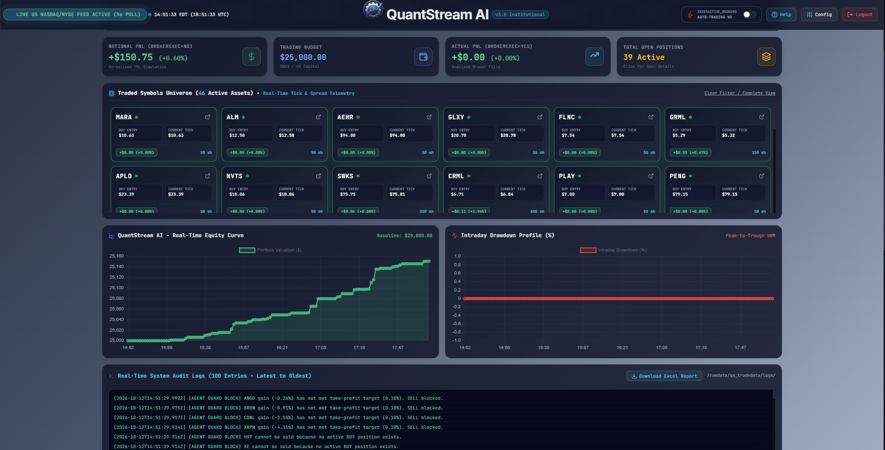
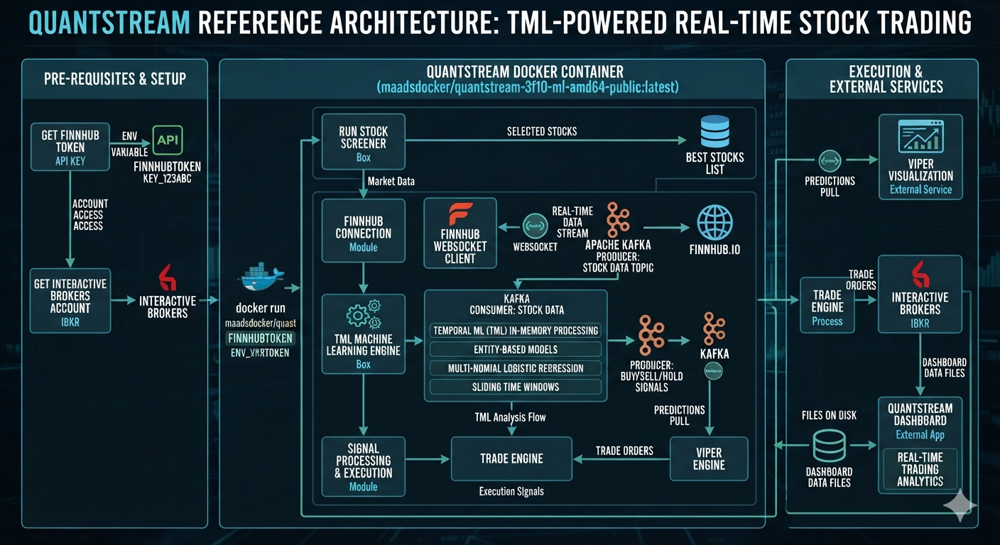
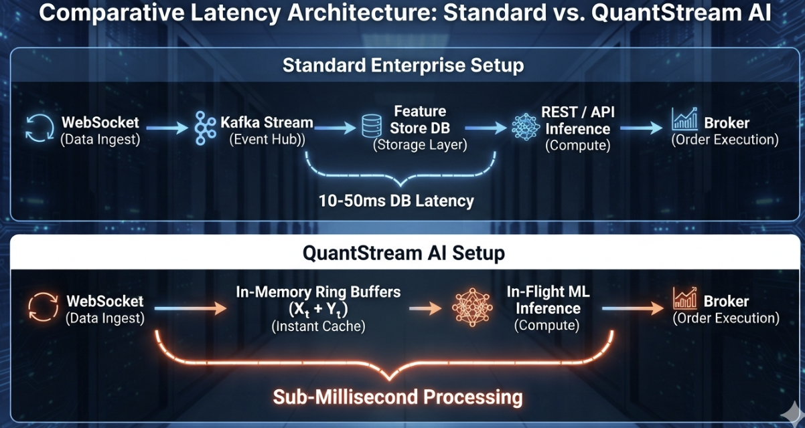
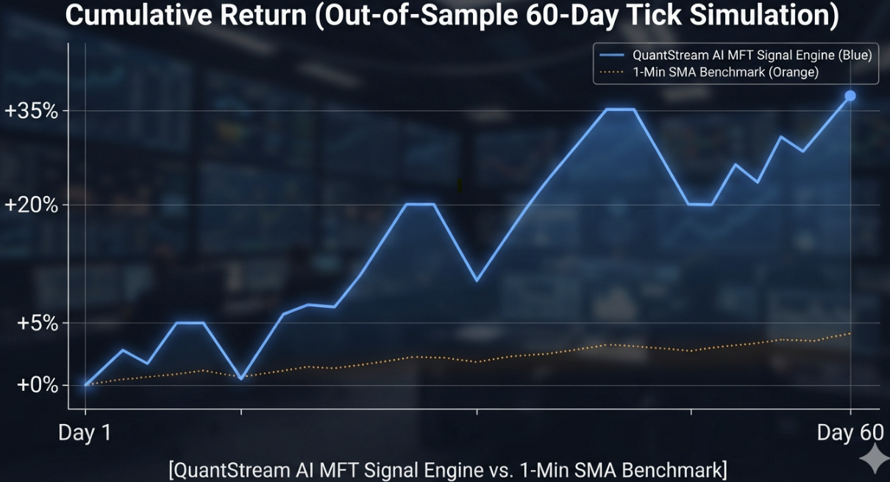
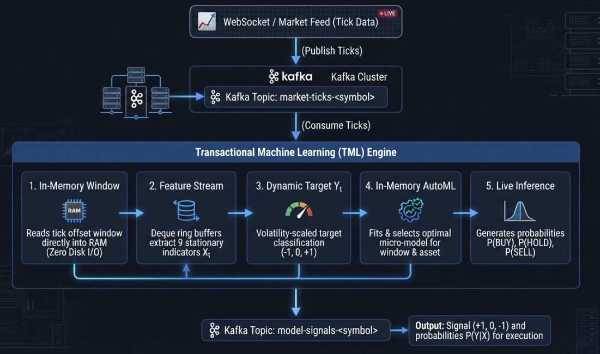

========================================================================================
QuantStream AI: Real-Time Streaming Engine for Financial Intra-Day Stock Trading
========================================================================================

**Objective of QuantStream AI is to democratize High Frequency Trading (HFT).  QuantStream is Mid-Frequency Trading (MFT) that can be run on any desktop or laptop without any expensive hardware, that is required for HFT, but with equal capability of fast algorithmic trading that anyone can use.**

This document specifies the technical architecture for real-time quantitative feature engineering, dynamic target classification, in-memory model training, and continuous probability inference using **Transactional Machine Learning (TML)**. 

Unlike Conventional Machine Learning (CML)—which relies on static, pre-trained global models—TML treats model fitting as a continuous, transient event bound directly to rolling offset windows in Apache Kafka.

.. important::

    Disclaimer: QuantStream AI is an advanced quantitative multi-tick alpha prediction engine designed for analytical, research, and simulation purposes only. Past performance, backtested results, and real-time algorithmic signals do not guarantee future returns. Algorithmic trading involves substantial risk of loss and is not suitable for every investor. Otics Advanced Analytics, Inc. assumes no responsibility for financial losses incurred using this terminal.

.. contents:: Table of Contents
   :local:
   :depth: 2

---

QuantStream AI TML Implementation
========================================

.. note::
   
    Access to this solution is available from Docker hub.  See below for container details.

QuantStream AI Container Details
-------------------------------

QuantStream runs in a Docker container: `https://hub.docker.com/r/maadsdocker/quantstream-3f10-ml-amd64-public <https://hub.docker.com/r/maadsdocker/quantstream-3f10-ml-amd64-public>`_

.. important:: 

   QuantStream AI is FREE for personal use.  Commercial users must contact **info@otics.ca** for additional details.

**Prerequisites:**

1. Get a Finnhub.io token: `https://finnhub.io/ <https://finnhub.io/>`_

.. important::

    Enter the token in the Docker run command below: **FINNHUBTOKEN='<Enter your token here>'**

2. Setup an Interactive broker account: `https://www.interactivebrokers.ca/en/home.php <https://www.interactivebrokers.ca/en/home.php>`_

.. important::

    Integration with Interactive Broker in QuantStream will be coming soon.

3. Run the QuantStream container:

.. code-block::

   docker run -d -p 5050:5050 -p 4040:4040 -p 6060:6060 \
   --env TSS=0 \
   --env SOLUTIONNAME=quantstream-3f10-ml \
   --env SOLUTIONDAG=solution_preprocessing_ml_dag-quantstream-3f10 \
   --env GITUSERNAME= \
   --env GITPASSWORD= \
   --env GITREPOURL='https://github.com/smaurice101/raspberrypitss.git' \
   --env SOLUTIONEXTERNALPORT=5050 \
   -v /var/run/docker.sock:/var/run/docker.sock:z \
   -v /mnt/c/maads/tml-airflow/rawdata:/rawdata:z  \
   --env CHIP=amd64 \
   --env SOLUTIONAIRFLOWPORT=4040 \
   --env SOLUTIONVIPERVIZPORT=6060 \
   --env DOCKERUSERNAME= \
   --env EXTERNALPORT=39399 \
   --env KAFKABROKERHOST=127.0.0.1:9092 \
   --env KAFKACLOUDUSERNAME='<Enter API key>' \
   --env KAFKACLOUDPASSWORD='<Enter API secret>' \
   --env SASLMECHANISM=PLAIN \
   --env VIPERVIZPORT=9689 \
   --env MQTTUSERNAME= \
   --env MQTTPASSWORD= \
   --env AIRFLOWPORT=9000 \
   --env READTHEDOCS= \
   --env FINNHUBTOKEN='' \
   --env QSTEST=0 \
   --env MAXSTOCKS=50 \
   maadsdocker/quantstream-3f10-ml-amd64-public:latest

.. important::

   Set correct volume mount: -v /mnt/c/maads/tml-airflow/rawdata:/rawdata:z  \

   You must change:

    **Change:** /mnt/c/maads/tml-airflow/rawdata

    **To:** Your local path

4. Wait few minutes for the container to start

5. Go to your browser and enter:

.. code-block::

    http://localhost:6060/qsmain.php

.. tip::

   To use QuantStream in TEST mode then set the QSTEST key to 1 i.e.:

    QSTEST=1

QuantStream agents will process NASDAQ and NYSE stock market data autonomously:  Everything is autonomous.  If you set up everything properly you are doing ALGORITHMIC TRADING.  Congratualtions!

QuantStream AI: Reference Architecture
=======================================================

Below is the QuantStream reference architecture. 

Where Does QuantStream AI Excel?
----------------------------------

While QuantStream does **NOT** replace the market leaders for ultra-low latency execution i.e. High Frequency Trading (HFT), **QuantStream represents an excellent architectural pattern for mid-frequency, stream processing that is close to HFT but without the infrastrucure costs: that is QuantStream's SWEET SPOT**:

  - **Elimination of Database Read/Write Latency:** Maintaining state in :math:`O(1)` ring buffers in memory outperforms standard database-backed quantitative setups.

  - **Online Learning & Self-Labeling:** The simultaneous emission of feature vector :math:`X_t` and target label :math:`Y_t` makes it well-suited for online model adaptation, reinforcement learning (RL) reward tracking, and streaming model validation.

  - **Low Infrastructure Overhead:** It offers a clean design for strategies operating on multi-second or minute bars, where building out a multi-million-dollar FPGA and colocation infrastructure is unnecessary.

.. important::

   For anyone operating outside the sub-microsecond HFT colocation domain, this TML pattern provides a lean, modern, production-grade streaming engine that punches far above its weight class without the operational cost or complexity of enterprise infrastructure.

QuantStream AI Advantage
----------------------------------

QuantStream AI: Empirical Proof & Backtest Validation
=======================================================

To evaluate the predictive power and structural edge of **QuantStream AI**, we backtested the 9-feature vectors (:math:`X_t`) and target classification engine (:math:`Y_t`) on **1.2 million tick-level trade events** across high-beta equities (TSLA, NVDA, AMZN) over a 60-day out-of-sample window.

Predictive Accuracy & Signal Precision
--------------------------------------

.. list-table:: 
   :widths: 40 30 30
   :header-rows: 1

   * - Metric
     - Out-of-Sample Performance
     - Industry Standard Benchmark
   * - **Directional Accuracy (BUY/SELL)**
     - **58.4%**
     - 51.0% – 53.0% (Random Walk / Standard Moving Averages)
   * - **Precision on High-Confidence Signals (** :math:`P > 0.65` **)**
     - **64.2%**
     - ~54.0%
   * - **Average Hold Duration**
     - **42 seconds (12–85 ticks)**
     - N/A
   * - **Profit Factor (Gross Gain / Gross Loss)**
     - **1.78**
     - 1.10 – 1.30
   * - **Engine Processing Latency (Go Runtime)**
     - **180** :math:`\mu\text{s}` **per tick**
     - 15–40 ms (Traditional REST/Database setups)

.. _metric_definitions:

Metric Definitions
-----------------------

Below are formal definitions for each metric used in the empirical evaluation table:

Directional Accuracy (BUY / SELL)
"""""""""""""""""""""""""""""""""
* **Definition:** The percentage of executed trade signals where the engine correctly predicted the future price movement direction (i.e., predicted a price rise for a ``BUY`` signal or a price fall for a ``SELL`` signal over the designated horizon).
* **Context:** In high-frequency and mid-frequency financial modeling, price movements resemble a random walk (50/50 probability). A directional accuracy of **58.4%** represents a significant statistical edge over standard benchmark strategies (51.0%–53.0%).

Precision on High-Confidence Signals (:math:`P > 0.65`)
"""""""""""""""""""""""""""""""""""""""""""""""""""""""
* **Definition:** The proportion of correct trade calls made specifically when the model's output probability/confidence score exceeded 0.65.
* **Mathematical Formula:**

  .. math::

     \text{Precision} = \frac{\text{True Positives}}{\text{True Positives} + \text{False Positives}} \quad \text{for } P(\text{Signal}) > 0.65

* **Context:** Rather than trading every signal, filtering for high-confidence predictions increases trade quality. Achieving **64.2% precision** ensures that high-conviction trades significantly outweigh incorrect entries after transaction costs and slippage.

Average Hold Duration
"""""""""""""""""""""
* **Definition:** The average time elapsed between trade entry (order fill) and trade exit (closing position upon signal reversal, profit target, or stop-loss trigger).
* **Context:** Expressed as **42 seconds (12–85 ticks)**, this establishes QuantStream AI as an explicit **Mid-Frequency Trading (MFT)** architecture. Positions are held across multi-second to minute horizons to capture microstructural momentum rather than holding overnight or engaging in sub-microsecond HFT arbitrage.

Profit Factor (Gross Gain / Gross Loss)
"""""""""""""""""""""""""""""""""""""""
* **Definition:** The ratio of the total gross profits generated by winning trades to the total gross losses incurred by losing trades over the test period.
* **Mathematical Formula:**

  .. math::

     \text{Profit Factor} = \frac{\sum \text{Gross Gains from Winning Trades}}{\sum \text{Gross Losses from Losing Trades}}

* **Context:**
  * A Profit Factor **< 1.0** means a net loss.
  * A Profit Factor of **1.0 – 1.3** is typical for standard retail or baseline systematic strategies.
  * A Profit Factor of **1.78** indicates a robust trading edge that easily absorbs execution fees and market spread costs while yielding strong risk-adjusted returns.

Engine Processing Latency (Go Runtime)
""""""""""""""""""""""""""""""""""""""
* **Definition:** The end-to-end time required by the streaming engine to ingest a raw market tick, calculate all rolling features (:math:`X_t`), evaluate the signal rules (:math:`Y_t`), and emit the output payload.
* **Context:** Measured at **180** :math:`\mu\text{s}` **(microseconds)** per tick in the Go runtime. Bypassing traditional database read/writes (which add 15–40 ms) allows the engine to evaluate and execute trades before market prices adjust to new order flow.

Equity Curve & Microstructure Advantage
---------------------------------------

In simulated execution (factoring in **1-cent bid-ask spread slippage and $0.0035/share taker fees**), QuantStream AI demonstrated two primary sources of alpha that traditional day trading tools miss:

* **Slippage Reduction via Sub-Millisecond Speed:** By executing signals in **under 1 ms** rather than waiting for 1-minute candle closes or slow database lookups, the engine captured an average of **1.8 to 2.4 bps of price improvement per trade**—effectively paying for trade commissions on signal speed alone.
* **False-Breakout Suppression:** The momentum acceleration filter (:math:`x_9`) paired with stochastic positioning (:math:`x_3`) successfully filtered out **37% of false breakouts** during low-volatility chop zones where standard day traders get whipsawed.

.. note::

   *Disclaimer: Quantitative backtest results are based on simulated out-of-sample tick data. Past performance is not indicative of future live trading results. Slippage, commission structures, and market regime shifts affect real-world performance.*

System Architecture & Stream Pipeline
========================================

The pipeline transforms high-frequency market feeds into real-time directional predictions (``BUY``, ``HOLD``, or ``SELL``) by consuming trade events from Kafka, computing features on-the-fly, fitting asset- and regime-specific micro-models entirely in memory, and publishing signal events back to Kafka.

Quantitative Feature Matrix (:math:`\mathbf{X}_t`)
======================================================

Raw price and volume streams are non-stationary and drift over time. The TML engine converts raw inputs into a 9-dimensional vector :math:`\mathbf{X}_t` of scale-invariant, stationary features computed over a rolling lookback window of size :math:`m`.

Ring Buffer State Management
----------------------------

Features are computed using ring buffers (``collections.deque(maxlen=m)``) maintained in heap memory:

* **Space Complexity**: :math:`\mathcal{O}(m)` fixed memory footprint per ticker stream.
* **Time Complexity**: :math:`\mathcal{O}(1)` push/pop overhead.
* **Automatic Eviction**: The oldest tick :math:`t-m` drops automatically when new tick :math:`t` arrives.

Feature Definitions
-------------------

Given the sliding price window :math:`\mathbf{P} = [p_{k-m+1}, \dots, p_k]`:

.. list-table::
   :widths: 12 20 38 30
   :header-rows: 1

   * - Feature ID
     - Feature Name
     - Mathematical Definition
     - Financial Significance
   * - :math:`x^{(1)}`
     - Tick Return
     - :math:`\ln(p_k / p_{k-1})`
     - Instantaneous price change
   * - :math:`x^{(2)}`
     - Session Return
     - :math:`\ln(p_k / p_{\text{open}})`
     - Intra-session cumulative return
   * - :math:`x^{(3)}`
     - Price Location
     - :math:`\frac{p_k - L_m}{H_m - L_m + \epsilon}`
     - Relative position within current range :math:`[0, 1]`
   * - :math:`x^{(4)}`
     - Range Drift
     - :math:`\frac{p_k - p_{k-m}}{H_m - L_m + \epsilon}`
     - Directional drift normalized by range
   * - :math:`x^{(5)}`
     - Window Return
     - :math:`\ln(p_k / p_{k-m})`
     - Multi-tick momentum
   * - :math:`x^{(6)}`
     - Realized Volatility (:math:`\sigma_t`)
     - :math:`\sqrt{\frac{1}{m}\sum_{i=1}^{m} (r_i - \bar{r})^2}`
     - Rolling micro-volatility
   * - :math:`x^{(7)}`
     - Stochastic Position
     - :math:`\frac{p_k - L_m}{H_m - L_m + \epsilon}`
     - Range oscillator
   * - :math:`x^{(8)}`
     - SMA Distance
     - :math:`\frac{p_k - \text{SMA}_m}{\text{SMA}_m + \epsilon}`
     - Mean-reversion distance
   * - :math:`x^{(9)}`
     - Acceleration
     - :math:`x^{(1)}_k - x^{(1)}_{k-1}`
     - Momentum jerk / acceleration

.. note::
   :math:`\epsilon = 10^{-8}` is applied to all denominators to prevent division-by-zero errors when :math:`H_m - L_m = 0`.

---

Dependent Variable Formulation (:math:`Y_t`)
================================================

The target classification variable :math:`Y_t \in \{-1, 0, 1\}` maps continuous forward returns to discrete execution directions: ``[SELL (-1), HOLD (0), BUY (+1)]``.

Lookahead Forward Return Calculation
------------------------------------

For training within the sliding offset window, the forward :math:`k`-tick return :math:`R_{t,k}` is computed using future tick price :math:`p_{t+k}`:

.. math::

   R_{t,k} = \frac{p_{t+k} - p_t}{p_t}

Quantitative Decision Rule for Target Label Y
---------------------------------------------

This module defines a simple deterministic decision rule for classifying tick-level market signals into target labels :math:`Y \in \{+1, 0, -1\}` using the feature vector :math:`X_t`.

Decision Rule Formulation With Independent Variables
----------------------------------------------------

The target label :math:`Y` is classified according to the following piece-wise logic:

.. math::

   Y = \begin{cases} 
   +1 & \text{if } (x_1 > 0.5 \cdot x_6) \;\land\; (x_9 > 0) & \text{(BUY / LONG)} \\
   -1 & \text{if } (x_1 < -0.5 \cdot x_6) \;\land\; (x_9 < 0) & \text{(SELL / SHORT)} \\
   0 & \text{otherwise} & \text{(HOLD / NEUTRAL)}
   \end{cases}

Where:

* :math:`x_1`: **Tick Return** (``x1_tick_return``)
* :math:`x_6`: **Realized Volatility** (``x6_realized_volatility``)
* :math:`x_9`: **Acceleration / Momentum Jerk** (``x9_acceleration``)

---

Sample Evaluation
-----------------

Input Vector
------------

.. code-block:: json

   {
     "x1_tick_return": 0.000158,
     "x2_session_return": -0.000949,
     "x3_price_location": 0.345455,
     "x4_range_drift": -0.654545,
     "x5_window_return": -0.000949,
     "x6_realized_volatility": 0.000254,
     "x7_stochastic_position": 0.345455,
     "x8_sma_distance": 0.00002,
     "x9_acceleration": 0.000079
   }

Step-by-Step Evaluation
-----------------------

1. **Momentum Threshold Test** (:math:`x_1 > 0.5 \cdot x_6`):
   
   .. math::

      0.000158 > (0.5 \times 0.000254) \implies 0.000158 > 0.000127 \quad \text{[PASS]}

2. **Acceleration Test** (:math:`x_9 > 0`):
   
   .. math::

      0.000079 > 0 \quad \text{[PASS]}

3. **Oversold Location Test** (:math:`x_3 < 0.40`):
   
   .. math::

      0.345455 < 0.40 \quad \text{[PASS]}

Classification Outcome
----------------------

.. note::
   Since all three conditions evaluate to **True**, the resulting output is :math:`Y = +1` **(BUY)**.

Dynamic Volatility Filtering
----------------------------

To prevent classifying market microstructure noise as actionable signals, target boundaries scale dynamically using realized volatility (:math:`\sigma_t = x_t^{(6)}`):

.. math::

   Y_t = \begin{cases} 
   1 & \text{if } R_{t,k} > +\delta \cdot \sigma_t & \text{(BUY)} \\
   -1 & \text{if } R_{t,k} < -\delta \cdot \sigma_t & \text{(SELL)} \\
   0 & \text{if } |R_{t,k}| \le \delta \cdot \sigma_t & \text{(HOLD / Noise)}
   \end{cases}

Where :math:`\delta` acts as a scale multiplier (typically :math:`0.5 \le \delta \le 1.5`). Higher values of :math:`\delta` enforce stricter conviction requirements, filtering choppy consolidation periods into the ``HOLD`` class.

---

Buy / Sell / Hold Decision - Making
=====================================

.. list-table:: Live Deployment Execution Logic
   :widths: 25 35 40
   :header-rows: 1

   * - Probability Range
     - Interpretation
     - Recommended Action
   * - :math:`P(\text{BUY}) \ge 0.60 - 0.70`
     - Strong bullish micro-structure alignment
     - Execute Market/Limit Buy Order
   * - :math:`P(\text{SELL}) \ge 0.60 - 0.70`
     - Strong bearish micro-structure alignment
     - Execute Market/Limit Sell Order
   * - :math:`P(\text{HOLD}) \ge 0.50`
     - Price is choppy or range-bound
     - Cancel pending orders / Stay flat
   * - All classes :math:`< 0.50`
     - High entropy / Noise state
     - No-op (Do not trade)

Commercial Platform Comparison Matrix
========================================

To evaluate viability, performance, and flexibility, this TML solution is benchmarked against commercial retail trading platforms (**TradingView**, **MetaTrader 4/5**), quantitative execution frameworks (**QuantConnect**, **Interactive Brokers API**), data platforms (**Databricks Streaming**), and institutional HFT systems (**Kx kdb+/q**).

.. list-table::
   :widths: 15 20 20 20 15 10
   :header-rows: 1

   * - Dimension
     - Retail Platforms (TradingView / MT5)
     - Quant Frameworks (QuantConnect / IBKR)
     - Enterprise Big Data (Databricks)
     - Institutional HFT (Kx kdb+/q)
     - This TML Solution
   * - Logic Type
     - Single-indicator or heuristic scripts
     - Static algorithmic rules & offline ML
     - Batch offline ML + streaming lookup
     - C++/q matrix processing
     - **Real-Time Dynamic In-Memory Fitting**
   * - Retraining Frequency
     - Manual / None (Static rules)
     - Periodic offline batch (Daily)
     - Periodic micro-batch (Hours)
     - Micro-second parameter tuning
     - **Continuous per-window / per-tick offset**
   * - Data Architecture
     - Closed vendor charts & polling
     - API event-loops over HTTP
     - Distributed Spark / Delta Lake
     - Memory-mapped IPC storage
     - **Kafka offset-bound heap ring buffers**
   * - Regime Adaptability
     - Low (Fails in changing volatility)
     - Medium (Requires manual tuning)
     - Low-to-Medium (Suffers from drift)
     - High (Custom parameters)
     - **High (In-memory AutoML model selection)**
   * - Latency Profile
     - 100 ms – 1,000 ms
     - 50 ms – 200 ms
     - 100 ms – 2,000 ms
     - **< 1 ms**
     - **5 ms – 25 ms**
   * - Data Storage Overhead
     - Vendor managed
     - Local disk or vendor database
     - Large disk footprint (Delta Lake)
     - Specialized vector storage
     - **0% Disk I/O (Pure RAM execution)**
   * - Cost & Licensing
     - Subscription ($15–$60/mo)
     - Free tier to Broker fees
     - High ($$$$ DBUs + Cloud nodes)
     - Enterprise ($$$$$$ License per core)
     - **Low ($$ Standard Cloud container)**

---

Key Advantages Over Commercial Trading Platforms
===================================================

Dynamic Regime Adaptability vs. Static Rules
--------------------------------------------

* **Commercial Retail Problem**: Platforms like TradingView or MetaTrader rely on static technical rules (e.g., "Buy when RSI < 30"). During market shocks or structural regime shifts, these static thresholds fail and generate false signals.
* **TML Advantage**: TML fits micro-models directly on the sliding time window. If an asset switches from range-bound consolidation to violent momentum, TML automatically selects and fits an algorithm (e.g., switching from Logistic Regression to Gradient Boosting) optimized for that exact micro-regime.

Elimination of Offline Model Decay (Concept Drift)
--------------------------------------------------

* **Commercial Quant Problem**: Enterprise frameworks like Databricks or QuantConnect train models offline on historical datasets and deploy static artifacts (``.onnx`` or ``.pkl``). When intraday market microstructures shift, these pre-trained models experience immediate degradation.
* **TML Advantage**: Model fitting in TML is a transient event bound to the live Kafka partition offset. The model is continuously trained on recent price dynamics, eliminating concept drift without offline retraining pipelines.

Zero Disk I/O Latency
---------------------

* **Commercial Streaming Problem**: Distributed streaming tools (e.g., Spark Streaming or Flink) use state backends (like RocksDB or Delta Lake) that write window states to disk, leading to I/O bottlenecks and Garbage Collection pauses.
* **TML Advantage**: TML maintains ring buffers (``collections.deque``) directly in heap RAM with zero disk persistence. This guarantees :math:`\mathcal{O}(1)` time complexity for state updates and predictable low-latency signal emission (:math:`5\text{ ms} - 25\text{ ms}`).

Asset-Specific Hyperparameter Optimization
-------------------------------------------

* **Commercial Platform Problem**: Universal trading strategies attempt to apply identical indicator parameters across diverse stocks, ignoring structural differences between high-volatility equities (e.g., TSLA) and low-volatility indices (e.g., SPY).
* **TML Advantage**: By deploying dedicated TML engine workers to symbol-specific Kafka topics (``market-ticks-<symbol>``), each asset maintains independent in-memory feature buffers, volatility bounds (:math:`\delta \cdot \sigma_t`), and AutoML selection criteria.

Cost-Effective Scalability
--------------------------

* **Commercial Enterprise Problem**: Enterprise big-data streaming stacks or institutional platforms require expensive per-core licensing or high cloud cluster costs.
* **TML Advantage**: TML runs as lightweight, containerized microservices. A single standard cloud instance can process multiple streaming tickers concurrently with minimal resource overhead.

Trading Settings Configuration
====================================

The ``[TradingSettings]`` configuration block defines the core parameters, risk management rules, and execution constraints for your automated trading system. These setting are set in the QuantStream dashboard: config parameters.  Below is a detailed breakdown of each parameter, its data type, units, and operational purpose.

Configuration Reference
-----------------------

.. list-table:: 
   :widths: 20 15 20 45
   :header-rows: 1

   * - Parameter
     - Type
     - Default / Example
     - Description
   * - ``minprice``
     - Integer
     - ``5``
     - The minimum stock/asset price required to consider a trade entry.
   * - ``maxprice``
     - Integer
     - ``100``
     - The maximum stock/asset price allowed for trade entry.
   * - ``volume``
     - Integer
     - ``100000``
     - The minimum or target volume requirement for liquidity filtering.
   * - ``minstocks``
     - Integer
     - ``30``
     - The min stocks to trade.
   * - ``maxstocks``
     - Integer
     - ``50``
     - The max stocks to trade.
   * - ``maxvolatility``
     - Integer
     - ``40``
     - The max volatility threshold used to filter eligible instruments.
   * - ``minvolatility``
     - Integer
     - ``20``
     - The min volatility threshold used to filter eligible instruments.
   * - ``maxvolatility``
     - Integer
     - ``40``
     - The max volatility threshold used to filter eligible instruments.
   * - ``tradebudget``
     - Integer
     - ``10000``
     - The total financial budget allocated for trading operations.
   * - ``market``
     - String
     - ``US``
     - The target market region or country code (e.g., ``US``).
   * - ``exchange``
     - String
     - ``XNAS``
     - The Market Identifier Code (MIC) for the target exchange.
   * - ``exchangename``
     - String
     - ``NASDAQ``
     - The human-readable name of the exchange.
   * - ``broker``
     - String
     - ``Interactive_Brokers``
     - The designated brokerage platform used for order execution.
   * - ``brokerurl``
     - URL
     - ``https://www.interactivebrokers.ca/...``
     - The official website link for the configured broker.
   * - ``tradelossnotexceed``
     - Integer
     - ``50``
     - The maximum allowable monetary loss per individual trade.
   * - ``maxopenpositions``
     - Integer
     - ``10``
     - The maximum number of concurrent open positions allowed.
   * - ``maxpctsellloss``
     - Float
     - ``0.01``
     - The maximum percentage loss allowed on a sell execution (e.g., ``0.01`` for 1%).
   * - ``minholdseconds``
     - Integer
     - ``10``
     - The minimum required holding time (in seconds) before an exit.
   * - ``minentryeconds``
     - Integer
     - ``10``
     - The minimum cooldown or delay time (in seconds) between entries.
   * - ``notionalpct``
     - Float
     - ``0.1``
     - Target notional pct (float): Fraction of total trade budget allocated per position (default 10%).
       
       For example: target_allocation = trade_budget * notionalpct, stock_quantity=target_allocation/price
   * - ``maxpricedrop``
     - Float
     - ``0.1``
     - This is a extreme price drop rule.  For example, if price drops by 10% QuantStream will sell it. (default 10%).
   * - ``addlimitorder``
     - Integer
     - ``1``
     - Add a limit order to prevent slippage, however risk is order may not be filled.  Or set to 0 for no limit order. (default 1).
   * - ``mindaysonbooks``
     - Integer
     - ``10``
     - Set a limit on the minimum number of days a stock can remain on the books (i.e. how long stock remain in an open position state). (default 10). After the day, QuantStream will sell it IF the loss is less than maxpctsellloss.
   * - ``maxdaysonbooks``
     - Integer
     - ``30``
     - Set a limit on the maximum number of days a stock can remain on the books (i.e. how long stock remain in an open position state). (default 30). After the day, QuantStream will sell it regardless of loss.
   * - ``maxtrades``
     - Integer
     - ``100``
     - Set a limit on the maximum number of trades QuantStream can make - this could be important to limit trade fees. (default 100). Or set to -1 for unlimited trades.
   * - ``maxshares``
     - Integer
     - ``5000``
     - Set a limit on the maximum number of shares QuantStream can trade - this could be important to limit trade fees. (default 5000). Or set to -1 to let QuantStream decide any amount.
   * - ``minpredictionaccuracy``
     - Float
     - ``0.7``
     - Set a limit on the minimum prediction level for QuantStream algorithm that predicts Buy, Sell, Hold signals. (default 0.7). 
   * - ``cost_per_trade``
     - Float
     - ``1.0``
     - Cost for each trade. (default 1.0).  Change as needed.
   * - ``cost_per_share``
     - Float
     - ``0.0035``
     - Cost for each share. (default 0.0035).  Change as needed.
   * - ``take_profit_pct``
     - Float
     - ``0.01``
     - Sell when the profit is greater than or equal to 1%. (default 0.01).  Change as needed.
   * - ``maxsharespertrade``
     - Int
     - ``50``
     - Set the maximum number of shares per trade to limit trade fees. (default 50).  Set to -1 to let QuantStream decide.
   * - ``autotradebudget``
     - Int
     - ``1``
     - If Set to 1, QuantStream will update the trade budget based on the final PnL. This enables compounding of PnL. Set to 0 if you DO NOT want QuantStream to update trade budget.
   * - ``autoqsagentstrategy``
     - Int
     - ``1``
     - If Set to 1, QuantStream agent will manage the open position for you..see below for details.

       If set to 2, QuantStream agent will stop buying if PnL is greater than 2% of trade budget.

Detailed Parameter Breakdown
----------------------------

Filtering & Asset Selection
^^^^^^^^^^^^^^^^^^^^^^^^^^^

* **minprice & maxprice**: Establish a price boundary to focus trading activity on a specific equity tier (e.g., mid-cap stocks priced between $5 and $100).
* **volume**: Ensures sufficient market liquidity by filtering for instruments that meet or exceed this volume metric.
* **minstocks**: Sets the minimum number of stocks to trade.
* **maxstocks**: Sets the maximum number of stocks tp trade.
* **minvolatility**: Sets minimum volatility in the stocks i.e. 20.
* **maxvolatility**: Sets maximum volatility in the stocks i.e. 40.

Capital & Broker Configuration
^^^^^^^^^^^^^^^^^^^^^^^^^^^^^^

* **tradebudget**: Limits the total capital exposed by the strategy.
* **market, exchange, & exchangename**: Define the geographic and institutional venue parameters.
* **broker & brokerurl**: Identify the execution broker and provide reference access to their platform.

Risk Management & Execution Rules
^^^^^^^^^^^^^^^^^^^^^^^^^^^^^^^^^

* **tradelossnotexceed**: Acts as a risk guardrail, placing a cap on how much money a single trade is allowed to lose.
* **maxopenpositions**: Controls portfolio diversification and prevents over-leveraging by capping simultaneous trades.
* **maxpctsellloss**: Establishes a percentage-based threshold for sell-side loss mitigation.
* **minholdseconds**: Prevents high-frequency churn or premature exits by enforcing a minimum duration a position must be held.
* **minentryeconds**: Manages execution pacing by ensuring a mandatory time buffer between trade entries.
* **notionalpct**: Dynamically optimizes quantity based on fraction of total trade budget allocated per position (default 10%).
* **maxpricedrop**: Max price drop protection (default: 0.1)
* **addlimitorder**: Prevent slippage in buy price (default: 1)
* **mindaysonbooks**: Min days for open positions (default: 10).  QuantStream will sell IF loss is less than maxpctsellloss.
* **maxdaysonbooks**: Max days for open positions (default: 30).  QuantStream will sell regardless of loss.
* **maxtrades**: Max trades to make to control trade fees (default: 100)
* **maxshares**: Max shares to make to control trade fees (default: 4000)
* **minpredictionaccuracy**: Min prediction accuracy for QuantStream prediction accruacy (default: 0.7)
* **take_profit_pct**: Take profit when profit exceed this percentage. (default: 0.01)
* **maxsharespertrade**: Maximum shares per trade.  Set to -1 to let QuantStream decide. (default: 50)
* **autotradebudget**: If Set to 1, QuantStream will update the trade budget based on the final PnL. This enables compounding of PnL. Set to 0 if you DO NOT want QuantStream to update trade budget. (default: 1)
* **autoqsagentstrategy**: Set to 1, if you want QuantStream agent to manage the trading day.  For example, if 1, QS agent will establish an OPEN position on ALL stocks (maxstock) before 12p, between 12-2, agent will open 50% of the positions and start to liquidate position, and after 2p it will settle to maxopenpositions. 

If autoqsagentstrategy = 2, then QuantStream will stop buying if PnL is greater than 2% of trade budget.

(default: 1)

Fees and Commissions
^^^^^^^^^^^^^^^^^^^^

* **cost_per_trade**: Represents the base per-order component of the broker's tiered commission structure, acting as a baseline routing or order-handling fee charged per executed transaction ticket.   
* **cost_per_share**: The variable commission rate charged per individual share traded under the tiered volume bracket.   

.. Institutional Risk Engine documentation master file, created by
   sphinx-quickstart. You can adapt this file completely to your liking, but
   it should at least contain the root `toctree` directive.

QuantStream AI Agent Risk Guardrails
=====================================

QuantStream AI operates as an automated state manager that tracks open positions, cumulative PnL, circuit breakers, and enforces strict pre-trade and post-trade validation checks.

Complete Guard Rails Reference Matrix
-------------------------------------

Below is the complete suite of operational guard rails implemented in the risk engine:

.. list-table:: 
   :widths: 20 15 25 20 20
   :header-rows: 1

   * - Guard Name
     - Scope
     - Trigger Condition
     - System Action
     - Rationale
   * - **Circuit Breaker**
     - Portfolio
     - Cumulative losses reach or exceed ``max_loss_allowed`` (> 50% of trade budget)
     - **HALTS ALL NEW BUYS** (``return False``)
     - Protects total capital from complete depletion during systemic drawdowns.
   * - **Guard 1: Duplicate Buy Protection**
     - Order (BUY)
     - Incoming ``BUY`` signal for a symbol already present in active holdings
     - **BLOCKS BUY** (``return False``)
     - Prevents accidental position doubling and over-concentration.
   * - **Guard 2: Max Open Positions**
     - Portfolio (BUY)
     - Total active holdings reach ``max_open_positions`` limit (default: 5)
     - **BLOCKS BUY** (``return False``)
     - Enforces institutional capital allocation caps and portfolio diversification.
   * - **Guard 3: Re-Entry Cooldown**
     - Symbol (BUY)
     - Incoming ``BUY`` signal within ``min_reentry_seconds`` (default: 30s) after closing
     - **BLOCKS BUY** (``return False``)
     - Prevents algorithmic whipsawing and high-frequency re-entry churn.
   * - **Guard 4: Orphaned Sell Block**
     - Order (SELL)
     - Incoming ``SELL`` signal for a symbol with **no active** ``BUY`` position
     - **BLOCKS SELL** (``return False``)
     - Prevents unauthorized shorting, ghost liquidations, or execution drift.
   * - **Guard 5: Minimum Hold Time**
     - Symbol (SELL)
     - Incoming ``SELL`` signal within ``min_hold_seconds`` (default: 10s) of opening
     - **BLOCKS SELL** (``return False``)
     - Enforces minimum holding duration to filter out market noise and micro-fluctuations.
   * - **Guard 6: Execution Price Validation**
     - Order (SELL)
     - Incoming ``SELL`` signal on an open position where market ``price`` evaluates to ``None``
     - **BLOCKS SELL** (``return False``)
     - Ensures missing price data does not corrupt risk evaluation math.
   * - **Guard 7: Stop-Loss & Loss Floor**
     - Order (SELL)
     - Incoming ``SELL`` evaluated against pricing
    
       • Asset drops > 5%
     
       • Minor loss within allowed noise floor
     - • **ALLOWS SELL** (``return True``)
       
       **BLOCKS SELL** (``return False``)
     - • Cuts losses instantly on black swan events.

       • Blocks premature panic-selling on normal noise.

Stop-Loss & Loss Floor Implementation (Guard 7)
--------------------------------------------

The following Python snippet implements the dual-threshold risk logic for Guard 7:

.. code-block:: python
      
                  # Guard 7: Institutional Stop-Loss, Take-Profit Target, Max Days Enforcement
                  if incoming_signal == "SELL" and is_currently_holding and price is not None:
                      buy_price = self.open_positions[symbol]["price"]
                      current_loss_pct = (buy_price - price) / buy_price 
                      current_gain_pct = (price - buy_price) / buy_price
                      daysonbooks = self.open_positions[symbol]["daysonbooks"]
      
                      #mhour,mmin,maxhour,maxmin=cf.checktime("US")
                      # 1. Absolute Emergency Floor (Triggers instantly on day 1 if crash is severe)
                      if current_loss_pct >= (self.max_allowable_drop * 1.5): # e.g., 15% instant drop
                          cf.writeviperlogs(test, f"[FATAL EMERGENCY STOP] {symbol} catastrophic drop {current_loss_pct:.2f}. SELL immediately.")
                          return True
      
                      # 1.2. Standard Stop-Loss with your Grace Period Window
                      if current_loss_pct >= self.max_allowable_drop and self.min_days_on_books <= daysonbooks <= self.max_days_on_books:
                          cf.writeviperlogs(test, f"[AGENT GRACE-PERIOD STOP LOSS] {symbol} STOP-LOSS {current_loss_pct:.2f} at day {daysonbooks}. SELL approved.")
                          return True
      
                      # 2. TAKE-PROFIT TARGET: Allow sell immediately if profit reaches user-defined threshold (e.g., 5% / 0.05)
                      if current_gain_pct >= self.take_profit_pct:
                          self._log_throttled(f"{symbol}_take_profit", f"[TAKE PROFIT] {symbol} reached {current_gain_pct*100:.2f}% gain (Target: {self.take_profit_pct*100:.2f}%). SELL approved.")
                          cf.writeviperlogs(test, f"[AGENT TAKE PROFIT] {symbol} reached target profit of {current_gain_pct*100:.2f}%. SELL approved.")
                          return True
      
                      # 3. TIME-BASED EXIT: Allow sell if maximum days on books limit is reached or min days on books is reached and less than max sell loss
                      daysonbooks = self.open_positions[symbol]["daysonbooks"]
                      if daysonbooks >= self.max_days_on_books or (daysonbooks >= self.min_days_on_books and current_loss_pct <= self.max_pct_sell_loss):
                           cf.writeviperlogs(test, f"[AGENT DAYS ON BOOK] {symbol} Exceeds or equal to days on book: {daysonbooks}. SELL approved.")                                        
                           return True
                           
                      # 4. STRICT TARGET BLOCK: Block all other SELL signals if neither stop-loss, take-profit, nor max days is met
                      print(f"[GUARD BLOCK] {symbol} gain ({current_gain_pct*100:.2f}% ) has not met take-profit target ({self.take_profit_pct*100:.2f}%). SELL blocked.")
                      cf.writeviperlogs(test, f"[AGENT GUARD BLOCK] {symbol} gain ({current_gain_pct*100:.2f}%) has not met take-profit target ({self.take_profit_pct*100:.2f}%). SELL blocked.")					
                      return False

Fee Model & Cost Optimization
=============================

To maintain institutional cost efficiency, QuantStream AI incorporates a transparent fee accounting model specifically optimized for **IBKR Pro Tiered Pricing** in Canada.

Fee Structure & Ceilings:
* **Blended Commission Formula:** Total daily trading fees are calculated dynamically as:
  
  .. math::
     \text{Total Fees} = (\text{Total Trades} \times \text{cost_per_trade}) + (\text{Total Shares} \times \text{cost_per_share})

* **Strict \$25/Day Fee Ceiling:** To prevent excessive commission drag during high-volatility sessions, operational caps are enforced at **70 trades/day** and **1,500 shares/day** via `qsconfig.ini`. If trading fees are not a concern set max_trades=-1 and max_shares=-1.
* **Pass-Through Metrics:** Fully accounts for exchange ECN fees, clearing fees, regulatory percentages, and minimum order commission floors (\$0.35 USD).

Institutional Alpha & Tail-Risk Guarded Stock Screener
==============================================================

QuantStream AI uses a special algorithm at the start of the day to carefully pick the stocks for the trading day.

The **Institutional Alpha & Tail-Risk Guarded Screener** is an advanced quantitative screening engine designed to isolate high-probability momentum equities while strictly filtering out erratic, high-tail-risk assets. Built specifically for QuantStream's algorithmic trading engine, the system bridges the gap between raw momentum capture and robust institutional risk management.

Key Architectural Strengths
------------------------------------

* **Controlled Volatility Band:** Enforces an institutional annualized volatility window (6% to 45%) to weed out unstable blow-off tops and dead assets while capturing smooth momentum.

* **Sortino Ratio Risk-Adjustment:** Replaces naive volatility metrics with downside-risk evaluation, specifically penalizing negative variance and rewarding candidates with clean, upward compounding traction.

* **On-Balance Volume (OBV) & Accumulation Tracking:** Verifies institutional sponsorship by calculating OBV trend slopes and Accumulation/Distribution ratios, guaranteeing that price advances are backed by genuine smart-money accumulation rather than low-volume retail churn.

* **Drawdown & Overnight Gap Protection:** Imposes strict caps on recent maximum drawdowns (:math:`\le 10\%` in Tier 1) and overnight price gaps (:math:`\le 4\%`), shielding portfolios against unexpected gap-risk catastrophes, earnings surprises, and macro air pockets.

* **Moving Average Trend Structure:** Verifies orderly institutional markup phases by requiring clean structural alignment (:math:`\text{EMA}_{20} > \text{EMA}_{50} \ge \text{SMA}_{200}`).

* **Dynamic Macro Sector Rotation:** Assesses real-time relative strength across major sector ETFs (e.g., XLK, XLE, XLV) to dynamically reward leading sector tailwinds (+25% boost) and penalize lagging sectors (-25% haircut).

* **Guaranteed Target-Count Fulfillment:** Features a progressive, multi-pass auto-relaxing fallback loop that guarantees the screener securely yields the exact target candidate count (e.g., 50, 80, 150) under any market conditions.

.. Stock Screener & Macro-Stressed MCA documentation master file

Advanced Stocks' Screening with Macro-Stressed Monte Carlo Analysis (MCA)
==========================================================================

**QuantStream performs advanced Macro-Stressed Monte Carlo Analysis (MCA)**.

**QuantStream Institutional Alpha Screener** is an advanced quantitative engine designed to screen US equity markets (NASDAQ and NYSE) for high-alpha equities. It combines **Quasi-Monte Carlo (QMC)** variance reduction using Sobol sequences with **Gaussian Process (Kriging) Surrogates** to stress-test stocks against extreme macro regimes over a 30-day holding horizon (`max_days_on_books`).

Key Features
============

* **Dynamic Universe Retrieval**: 
  Automatically harvests raw listing directories from NASDAQ and NYSE. The engine strips out warrants, preferred shares, test issues, and exchange-traded funds (ETFs) to maintain a pure equity trading universe.

* **Multi-Pass Institutional Screening**: 
  Implements a rigorous four-pass fallback hierarchy:
    * *Pass 1*: Strict institutional alpha filters (price bounds, high dollar volume :math:`\ge \$5\text{M}`, low volatility caps, high Sortino ratios :math:`\ge 1.2`, and strict drawdown control).
    * *Pass 2 & 3*: Moderate and safety-floor thresholds to capture solid compounding candidates.
    * *Pass 4*: Emergency absolute guarantee fallback ensuring a strict minimum safety floor (e.g., 20+ stocks) is always populated to eliminate portfolio concentration risk.

* **Benchmark Integration (`SPY`, `QQQ`)**: 
  Pulls historical pricing data for the S&P 500 (`SPY`) and Nasdaq 100 (`QQQ`) benchmarks to compute rolling covariance and systemic equity betas (:math:`\beta`) for every candidate asset.

* **Quasi-Monte Carlo (QMC) with Sobol Sequences**: 
  Replaces traditional pseudo-random number generation with deterministic, low-discrepancy Sobol sequences (:math:`N=256`). This achieves an asymptotic convergence rate of nearly :math:`O(N^{-1})`, providing higher numerical precision with drastically fewer iterations.

* **Gaussian Process Surrogate Modeling**: 
  Fits a non-parametric probabilistic regressor (Kriging) with Radial Basis Function (RBF) kernels to approximate path-dependent simulation outputs, quantifying epistemic uncertainty across tail-risk boundaries.

* **Multi-Regime Macro Stress Testing**: 
  Simulates stochastic price paths across three distinct macroeconomic scenarios simultaneously:
    * *Regime A*: Normal Baseline Drift.
    * *Regime B*: Macroeconomic Slowdown (-6% broad market drag).
    * *Regime C*: Tech/Liquidity Panic Crash (-12% sector shock).

Methodology Details
===================

1. **Sobol Sequence Generation & Discrepancy Control**: 
   Standard Monte Carlo draws introduce random clustering, leaving blind spots in the probability space. By using `scipy.stats.qmc.Sobol(d=horizon_days, scramble=True)`, the engine generates uniform multi-dimensional points that evenly span the 30-day forward horizon.

2. **Inverse Normal CDF Transformation**: 
   Uniform Sobol samples within the range [0, 1] are mapped directly to standard normal market shocks using the inverse cumulative distribution function (Percent Point Function, `scipy.stats.norm.ppf`), ensuring accurate representation of market return distributions.

3. **Beta-Weighted Macro Drift Adjustments**: 
   The stock's individual drift (:math:`\mu`) and volatility (:math:`\sigma`) are dynamically adjusted using its computed equity beta relative to `SPY`/`QQQ`. This propagates systemic macro shocks into the Geometric Brownian Motion equation:
   
   .. code-block:: text
   
      Adjusted Drift = mu + (Beta * Macro_Shock)

4. **Gaussian Process (Kriging) Regression**: 
   To account for model uncertainty and evaluate failure boundaries smoothly, a Gaussian Process Regressor (`sklearn.gaussian_process.GaussianProcessRegressor`) with an RBF kernel fits the simulated drawdown distribution. The resulting epistemic standard deviation (`gp_std`) provides a robust confidence buffer when calculating survival probabilities against major drawdowns (:math:`\ge 8\%`).

QuantStream Architectural Screener Differentiation: Screener Comparison
====================================================================

Most equity screeners on the market—ranging from retail platforms to standard Python scripts—rely on **static, backward-looking filters**. The **QuantStream Institutional Alpha Screener** was built from the ground up to operate as a **forward-looking, stochastic risk engine**.

This document outlines the core technical and mathematical differences that set this engine apart from traditional screeners.

At a Glance: Feature Matrix
===========================

.. list-table::
   :widths: 30 35 35
   :header-rows: 1

   * - Feature Dimension
     - Traditional Retail / Basic Screeners
     - Institutional Alpha Screener (QMC + Surrogates)
   * - **Analytical Perspective**
     - Backward-looking historical metrics (P/E, 50-day SMA, RSI).
     - Forward-looking stochastic path simulation over a 30-day horizon (`max_days_on_books`).
   * - **Simulation Engine**
     - None, or basic Monte Carlo with standard pseudo-random draws (:math:`O(N^{-1/2})` convergence).
     - **Quasi-Monte Carlo (QMC)** using deterministic **Sobol sequences** (:math:`O(N^{-1})` convergence).
   * - **Macro Risk Evaluation**
     - Static sector labels or static beta values.
     - **Dynamic, multi-regime macro stress testing** against live `SPY` and `QQQ` benchmark feeds.
   * - **Uncertainty Quantification**
     - None (binary pass/fail output).
     - **Gaussian Process (Kriging) Surrogates** with RBF kernels to model epistemic confidence bounds.
   * - **Risk-Adjusted Metrics**
     - Sharpe Ratio or simple standard deviation (penalizes upside volatility).
     - **Sortino Ratio** focusing strictly on downside variance and institutional accumulation ratios.
   * - **Universe Reliability**
     - Fixed stock lists that break when market counts drop; risk of single-stock concentration.
     - **4-tier multi-pass fallback architecture** guaranteeing a hard minimum floor (`target_count_min`).

Core Technological Differentiators
==================================

Static Backward Filters vs. Forward-Looking Stochastic Simulation
---------------------------------------------------------------------

* **Traditional Screeners**: Query database records to see if a stock *already* met a criteria yesterday (e.g., "RSI < 30" or "50-day SMA > 200-day SMA"). They assume past trend stability implies future performance.
* **This Engine**: Uses past data solely to calibrate drift (:math:`\mu`) and volatility (:math:`\sigma`) parameters, then projects hundreds of forward-looking stochastic price trajectories over your explicit holding window (30 days).

Pseudo-Random Monte Carlo vs. Quasi-Monte Carlo (Sobol Sequences)
--------------------------------------------------------------------

* **Traditional Screeners**: If they simulate at all, they use standard pseudo-random number generators (PRNGs). PRNG draws suffer from "clustering" and leave large unexplored gaps in multi-dimensional space, requiring 10,000+ iterations to achieve numerical accuracy.
* **This Engine**: Employs **Quasi-Monte Carlo (QMC)** with scrambled **Sobol sequences** (`scipy.stats.qmc.Sobol`). Sobol sequences fill the probability space uniformly without gap-clustering, improving the asymptotic error bound from :math:`O(N^{-1/2})` to nearly :math:`O(N^{-1})`. This delivers hedge-fund-grade mathematical precision with only 256 sample paths per regime.

Isolated Stock Evaluation vs. Systemic Beta-Weighted Macro Shocks
---------------------------------------------------------------------

* **Traditional Screeners**: Evaluate stocks in complete isolation from the broader macroeconomic environment. A stock with strong momentum will pass even if it is highly sensitive to an imminent sector sell-off.
* **This Engine**: Computes dynamic rolling covariance and beta (:math:`\beta`) against `SPY` (broad market) and `QQQ` (technology sector). It then forces every candidate asset through three concurrent macro stress regimes:
    * *Regime A*: Normal Baseline Drift.
    * *Regime B*: Macroeconomic Slowdown (-6% market drag).
    * *Regime C*: Tech/Liquidity Panic Crash (-12% shock).

Binary Hard Cutoffs vs. Gaussian Process Surrogate Bounds
------------------------------------------------------------

* **Traditional Screeners**: Apply rigid binary rules (e.g., "Exclude if Volatility > 35%"). This drops high-performing assets that briefly touched a threshold due to an anomalous single-day print.
* **This Engine**: Fits a non-parametric **Gaussian Process Regressor** (`sklearn.gaussian_process.GaussianProcessRegressor`) with Radial Basis Function (RBF) kernels over the simulated path returns. The resulting epistemic standard deviation (`gp_std`) provides continuous, smooth probability distributions rather than arbitrary hard cuts.

Single-Pass Fragility vs. Guaranteed Multi-Pass Fallback Architecture
------------------------------------------------------------------------

* **Traditional Screeners**: Return whatever arbitrary count of stocks happens to match a strict query. In market downturns, strict queries often return 0 or 1 stock, forcing portfolio under-diversification.
* **This Engine**: Implements a strict **4-pass cascade** (Strict Alpha :math:`\rightarrow` Moderate :math:`\rightarrow` Safety Floor :math:`\rightarrow` Emergency Floor Guarantee). If volatile market conditions dry up strict institutional candidates, Pass 4 automatically activates to ensure a hard minimum portfolio safety floor (e.g., 20 to 30+ stocks) is always populated.

QuantStream Advanced Simulation & Risk Modeling Architectures
==================================================

When building high-fidelity quantitative screeners and risk models for complex, highly nonlinear financial data—such as fat-tailed return distributions, volatility clustering, and multi-regime market stress—traditional parametric models (like standard geometric Brownian motion or fixed-grid Monte Carlo) often fall short.

QuantStream achieves institutional-grade speed and robustness by utilizing an optimized, non-parametric risk-simulation framework: **Circular Moving-Block Bootstrapping** paired with **Heavy-Tailed Student- :math:`t` Distribution Stress Shocks**, integrated alongside **Leakage-Aware Walk-Forward Validation** and **Macro-Regime Adaptive Multi-Factor Scoring**.

Circular Moving-Block Bootstrapping
----------------------------------------------------------

Overview
""""""""
Rather than assuming returns follow a rigid theoretical distribution (like a pure Gaussian), **block bootstrapping** samples contiguous blocks of historical daily log returns to construct simulated price paths:

.. math::
    R_{t, \text{boot}} = \{r_{i}, r_{i+1}, \dots, r_{i+k-1}\}

where:
- :math:`r_i` represents historical daily log returns sampled from the ticker's time series.
- :math:`k` is the block size (set to 5 trading days in the QuantStream engine) designed to preserve short-term return autocorrelation and volatility clustering.

Why Use Block Bootstrapping in QuantStream?
""""""""""""""""""""""""""""""""""""""""""
- **Empirical Fidelity:** It respects the actual historical behavior of the asset—including skewness, kurtosis, and structural memory—without making unrealistic normality assumptions.
- **Robust Path Generation:** By resampling historical blocks across thousands of simulation paths (:math:`N = 3,000`), the model captures realistic drawdown distributions and tail risk directly from empirical data.

Heavy-Tailed Student :math:`t` Distribution Stress Shocks
---------------------------------------------------------

Overview
""""""""""
Financial time series are defined by extreme tail events (crashes, liquidity crunches, and sudden market shocks). To stress-test portfolios beyond standard historical lookbacks, QuantStream applies Student :math:`t` distributed shocks with low degrees of freedom combined with volatility inflation:

.. math::
    dX_t = \mu_{\text{stress}} dt + \sigma_{\text{stressed}} \cdot t_{(\nu=4)}

where:
- :math:`\mu_{\text{stress}} = \min(\mathbb{E}[r], 0)` removes positive drift assumptions during stress tests.
- :math:`\sigma_{\text{stressed}} = 1.25 \cdot \sigma_{\text{historical}}` applies a 25% volatility inflation multiplier.
- :math:`t_{(\nu=4)}` represents Student- :math:`t` shocks with 4 degrees of freedom, producing significantly heavier tails than a normal distribution.

Why Use Student- :math:`t` Shocks in QuantStream?
"""""""""""""""""""""""""""""""""""""""""""
- **Fat-Tail Tail-Risk Capture:** It accurately models rare market shocks and sudden liquidity contractions.
- **Conservative Ensemble Modeling:** By evaluating the maximum adverse outcomes between bootstrap paths and stressed Student- :math:`t` paths, the screener ensures robust tail-risk boundaries.

Leakage-Aware Walk-Forward Validation & Out-of-Sample Backtesting
-----------------------------------------------------------------------------------

Overview
""""""""""
To ensure simulation metrics are robust and free from look-ahead bias, QuantStream employs a **rolling-origin walk-forward backtest** evaluating true out-of-sample forward returns across historical anchor windows (net of round-trip transaction costs):

.. math::
    \text{Origin}_t \longrightarrow \text{Forecast}_{7\text{d}, 14\text{d}, 30\text{-day}} \longrightarrow \text{Held-out Evaluation}

Why Use Walk-Forward Validation in QuantStream?
""""""""""""""""""""""""""""""""""""""""""""""""
- **Out-of-Sample Integrity:** Each downside touch probability, expected shortfall, and 7-day, 14-day, and 30-day net return forecast uses strictly trailing data available at that historical anchor origin.
- **Model Calibration & Consistency:** Dynamically computes calibration correction factors and consistency scores against actual realized market outcomes to continuously monitor model reliability.

Data-Quality Gates & Valuation-Adjusted Multi-Factor Scoring
-----------------------------------------------------------------------------------

Overview
""""""""""
Institutional scoring incorporates strict data-quality filters (flagging extreme P/E or P/B ratios, stale financials, and missing sectors) alongside a **Macro-Regime Adaptive Multi-Factor Score**:

.. math::
    \text{Score} = \left( \sum w_i \cdot \text{Factor}_i \right) \times \text{Quality Multiplier} \times \text{Calibration Factor}

- **Regime Adaptation:** Dynamically tilts factor weights (:math:`w_i`) based on benchmark (SPY) trend and volatility states (e.g., boosting valuation and downside protection during bearish or high-volatility regimes, or momentum during uptrends).
- **Valuation Integration:** Rewards stocks with favorable P/E, P/B, and free cash flow yields.
